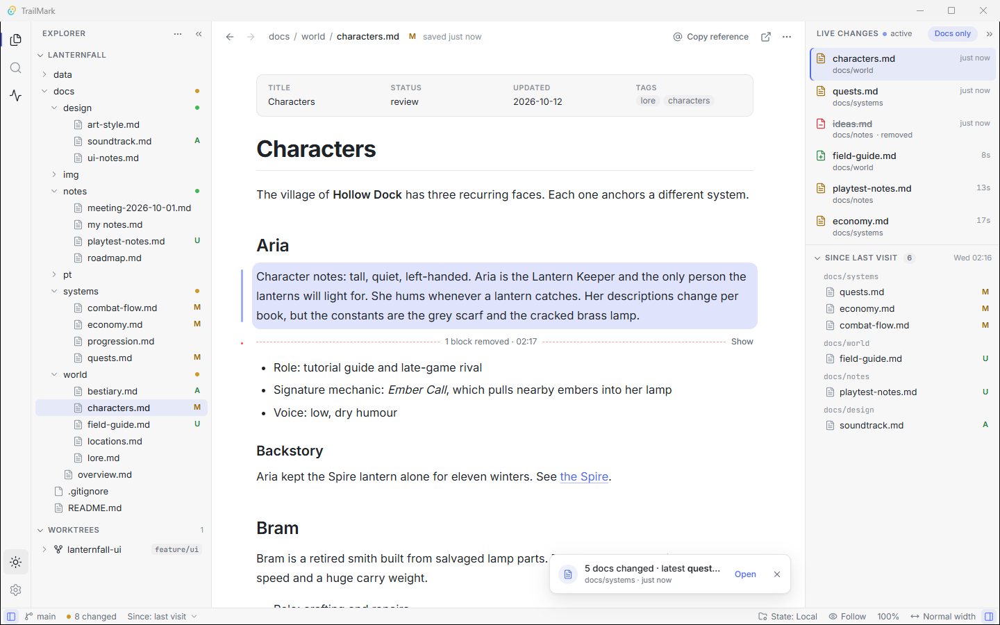
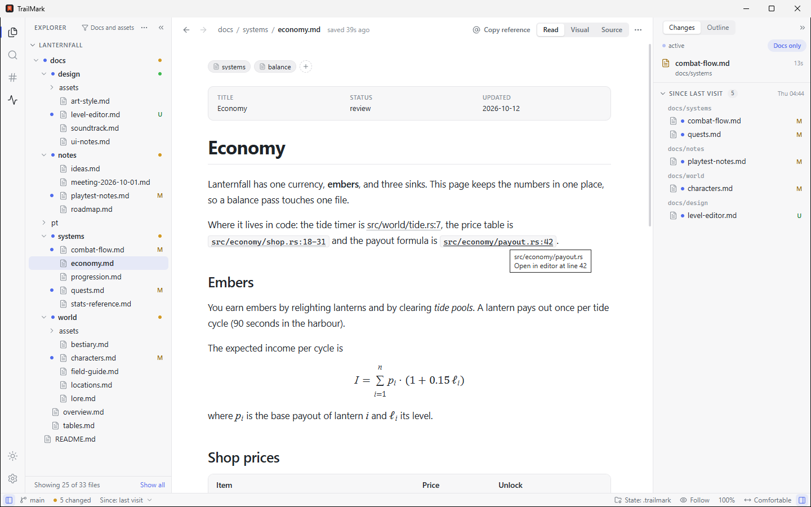
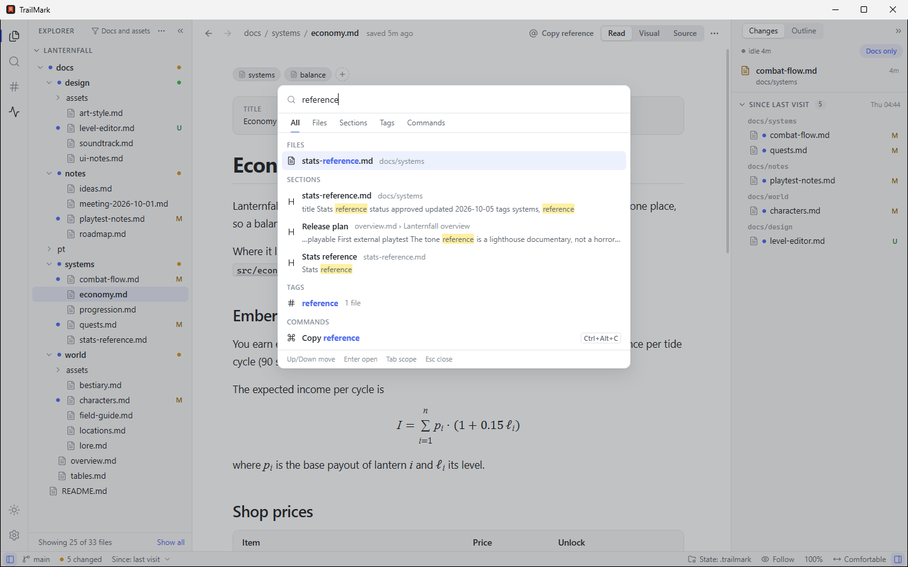
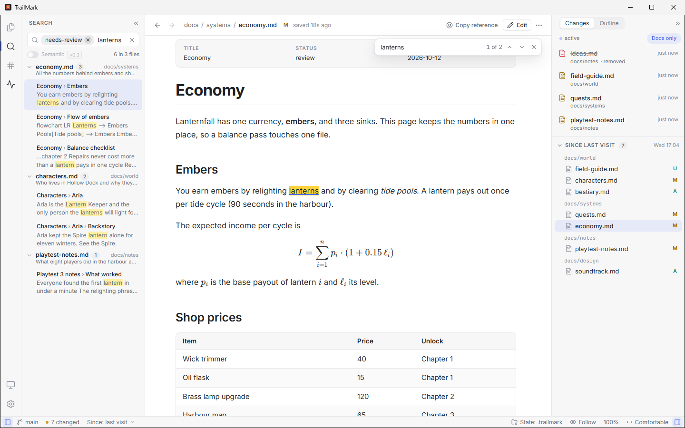
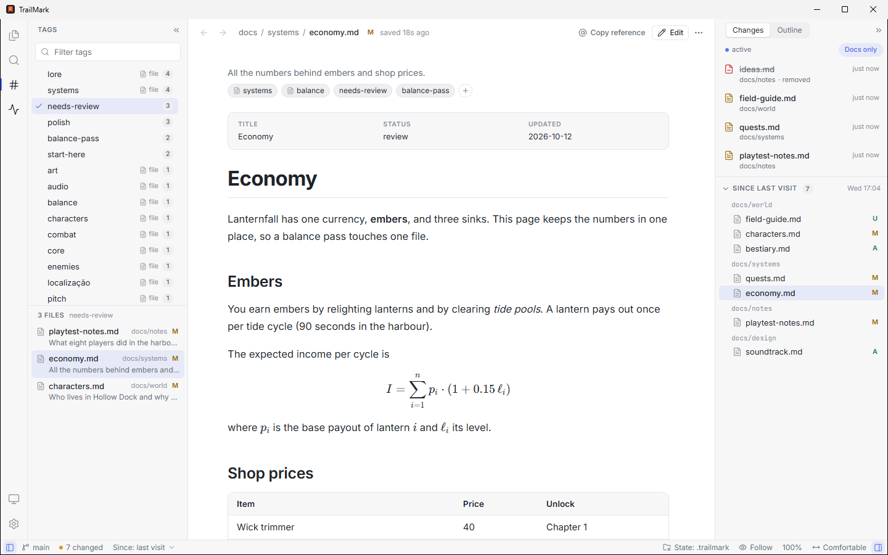
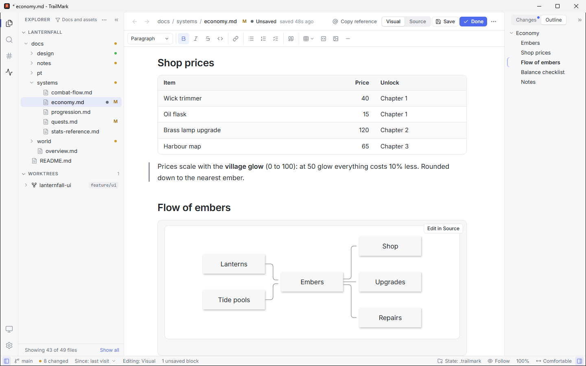
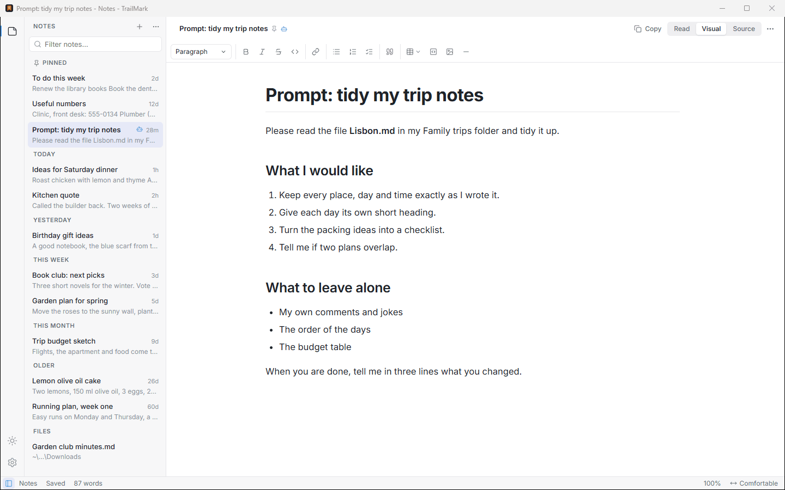
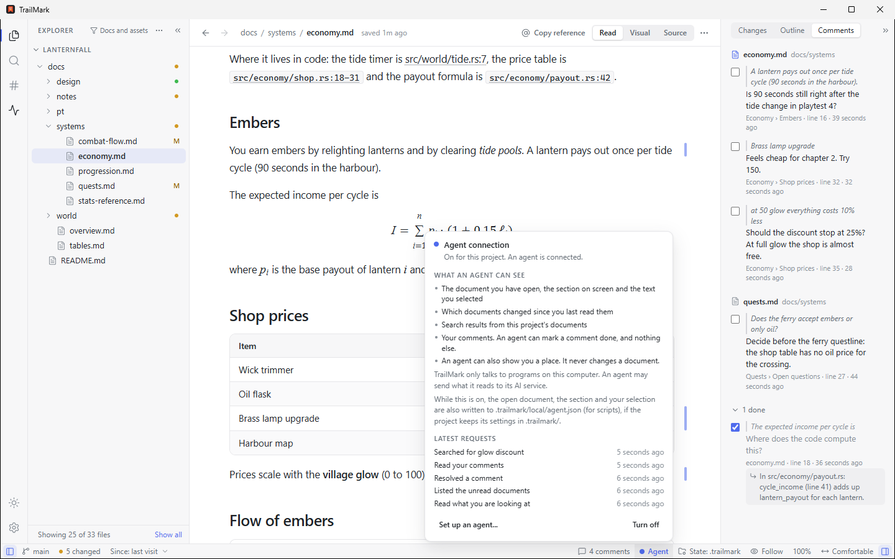
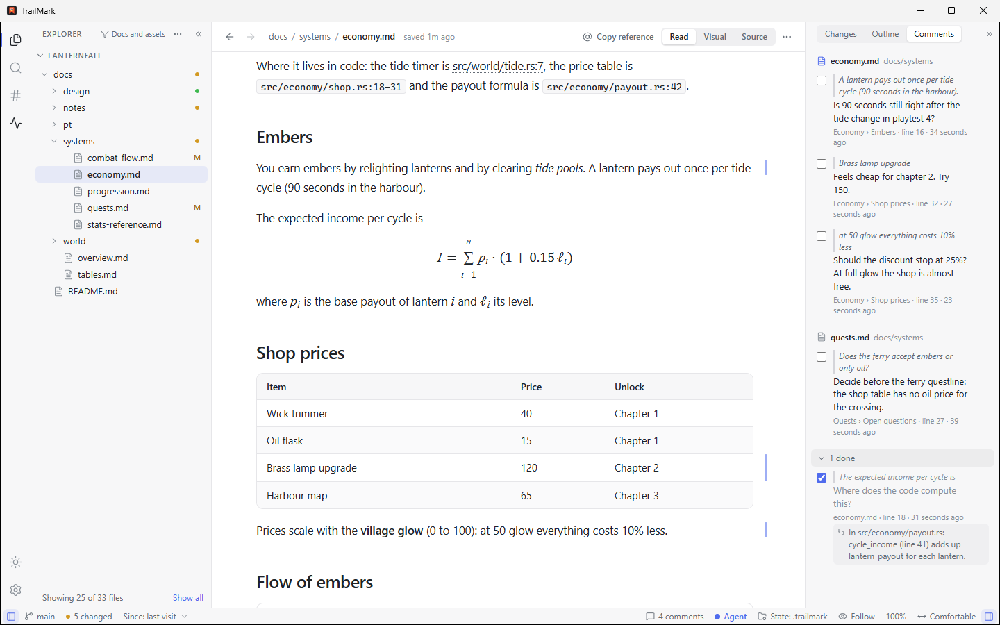

<div align="center">


# TrailMark

**Read what your AI writes. Write what it reads.**

TrailMark is a free, open-source Markdown app for Windows, macOS and Linux, built for the reader. It opens any `.md` file as a
clean page, keeps notes that save themselves, and turns a project folder into an IDE where you follow, review and steer what
your AI agents write. It works with any AI tool, or with none.

Created and maintained by [Edelmar Schneider](https://github.com/EdelmarSchneider).

[Features](#features) · [Install](#install) · [Usage](#usage) · [Shortcuts](#keyboard-shortcuts) · [Roadmap](#roadmap) · [Contributing](#contributing)

<picture>
  <source media="(prefers-color-scheme: dark)" srcset="docs/assets/screenshot-dark.png">
  
</picture>

</div>

---

## Where to start

### Build with AI agents?

Your agents write the plans, specs and reports. Your job is to read them, judge them and steer. TrailMark is the IDE for that
job: open the project folder and keep it next to your terminal. It doesn't run your agent; it shows you what your agent writes.

- **Watch.** Changed passages glow as your agent writes, removed ones leave a marker, and a live feed lists every file it
  touches, across git worktrees too. A reload keeps your place.
- **Review.** Unread dots mark every document that changed since you last read it, like new mail. Git badges and a "since your
  last visit" view still work after the agent has committed.
- **Find.** One search for every file, section, tag and command, and code references like `src/main.rs:42` that open at the
  line in the editor you choose.
- **Steer.** Select a passage, press `C` and write a comment. With the optional [agent connection](#use-with-an-ai-agent) (MCP),
  your agent reads your open comments, marks them done with a reply, and knows which document, section and words you mean when
  you say "rewrite this".
- **Edit next to it, safely.** Only the blocks you change are rewritten, and if your agent changes a file while you edit it, you
  choose **Reload theirs** or **Keep mine**.

More in [Follow your agents live](#-follow-your-agents-live) and [Use with an AI agent](#use-with-an-ai-agent).

### Got a .md file?

Your AI, a colleague or a download gives you a `.md` file. Open it with TrailMark and read it as a page, not a wall of symbols.

- **It reads like a page.** Tables, checklists, highlighted code, Mermaid diagrams, math, alerts and footnotes, in light or dark,
  with three reading widths and a focus mode.
- **Links work.** Relative links and anchors open in the app, with back and forward and an outline of the headings.
- **You can fix it.** Edit visually, with a toolbar, or in Source. Only the blocks you changed are saved, and the rest of the file
  stays exactly as it was.
- **Notes that save themselves.** Press `Ctrl+Shift+N` in TrailMark and type. No name to choose, no folder to pick, and closing
  never asks. Pin the notes you keep, bring back an earlier version, and copy a drafted prompt to your AI as clean Markdown.
- **Your files are safe.** A file you open is listed next to your notes and written only when you press `Ctrl+S`. TrailMark is
  listed under **Open with** for Markdown files and never makes itself your default app: that choice stays yours.

More in [Reading that feels like a book](#-reading-that-feels-like-a-book) and [Notes](#-notes).

Either way, TrailMark only relies on your **filesystem and git**. It works the same with Claude Code, opencode, Cursor, Aider,
Codex or Gemini CLI, or with none.

## Why Markdown

**Markdown was made for readers. So is TrailMark.** It was designed in 2004 so that plain text reads well as it is. Twenty years
later, AI adopted it for the same reason: it is structured enough for a machine and clear enough for a person. TrailMark is the
reader's tool for it.

It is also an opinion: many documents that live in Word or PDF today would be better as Markdown. They would be smaller,
comparable line by line in git, readable by any AI, and never locked inside one app.

## Features

### 📖 Reading that feels like a book
- GitHub-flavored Markdown: tables, task lists, footnotes, alerts (`> [!NOTE]`), description lists
- **Mermaid** diagrams, **KaTeX** math, syntax-highlighted code with copy buttons
- Frontmatter shown as a clean metadata card
- Light and dark themes, adjustable zoom, and a focus mode with both side panels collapsed
- Three **reading widths**: Comfortable (a book-like column), Wide and Full. Wide tables, diagrams and images take the room
  they need while the text stays at a comfortable measure
- JSON, XML and plain text through an extensible renderer registry

### 🧭 Navigate like a wiki
- Open a **folder** for IDE mode (tree, search, live feed) or a **single file** for a distraction-free reader
- Relative links, anchors and images resolve inside the app, with back and forward history
- An **Outline** of the open document's headings (`Ctrl+Alt+O`): the section you're reading is marked, click a heading to jump,
  collapse sections you don't need. It keeps working while you edit, and a dot marks the sections an agent just changed
- A **filter** for the Explorer (Documents, Docs and assets, Everything, or your own patterns) keeps a code repository's tree to the
  documents that matter, and tells you how many files it hides
- Workspaces that collect several repositories show each one, even when the parent's `.gitignore` leaves it out. Hidden
  files and files ignored by git have their own switches in the filter, off by default
- The window opens where you left it, with its own size and place for each project, and its title names the document and the project,
  so several windows are easy to tell apart in the taskbar and `Alt+Tab`
- The Explorer **follows the file you open**, however you got there: quick open, a link, search, the feed, back and forward
- Quick open (`Ctrl+P`), find in page (`Ctrl+F`), session restore and recent projects
- **Code references are links.** `src/main.rs:42`, `lib.rs#L10-L20` or `` `docs/plan.md` `` in a document opens the file at the line:
  Markdown in TrailMark, anything else in your editor (VS Code, Cursor, Zed, Sublime Text, JetBrains IDEs or a command of your own,
  in **Settings → External editor**). Only names of files the project really has become links
- One process per project: `trailmark ~/code/my-project`

### 🖼️ Pictures, sound and video
- **Images open in the pane.** PNG, JPEG, GIF (animated), WebP, AVIF, BMP, ICO and SVG. A picture is fitted to the window; click it, or use the
  button, to see it at 100%, and `Ctrl+=`, `Ctrl+-` and `Ctrl+0` zoom it the way they zoom text (`Ctrl+0` fits it again). A checkerboard
  shows through transparency, in light and dark. The header gives the size in pixels and on disk. A picture that changes on disk
  (an agent regenerating a screenshot) reloads by itself. An SVG is drawn as an image, never inline, so nothing in it can run.
- **Audio and video play in the pane**, in the window's own player: MP3, WAV, OGG, Opus, FLAC, M4A, AAC and WebM audio; MP4, M4V, WebM,
  OGV and MOV video. A long file is read in parts as it plays, so it starts at once, seeks freely and is never loaded whole. A format or
  codec the window cannot play (MKV, AVI, WMV and the like) says so, and offers the program your system has for it.
- **Documents can use them.** `<video>` and `<audio>` tags play in place, next to the document, and a link to a media file opens it in the
  pane. Nothing starts by itself: `autoplay` is dropped, and a player only reads the length of its file until you press play.
- **Open with default app** hands a file the pane cannot show to the program your system has for its type: a button in the pane, an item
  in the Explorer's right-click menu, and a command (`Ctrl+Shift+P`). Programs and scripts (`.exe`, `.bat`, `.ps1`, `.sh`, `.app`,
  `.lnk`, installers, Office documents that can hold macros such as `.docm`, `.doc` and `.xls`, and the like) are never opened from a click; TrailMark says which kind of file it refused and offers
  to show it in the file manager. Files outside the open folder are never served, and a link that leaves it is not followed.
- **The Explorer filter has an Audio and video category.** *Docs and assets* shows them by the same rules as images: next to a document, in
  a folder named like `assets`, `images`, `video`, `audio` or `clips`, or when a document links to them. Quick open and Search everywhere
  find pictures, sound and video by name whatever the filter hides, and list **folders** too: pick one to reveal it in the Explorer.

### ⚡ Follow your agents live
- Documents reload **without losing your scroll position**
- **Changed blocks glow** and fade; **removed blocks leave a marker** you can expand
- **Live changes** feed: one entry per file, bursts grouped, `git checkout` storms collapsed into one line
- **Follow mode** automatically opens the doc the agent is writing (rate-limited, never jumps while you're selecting)
- Git worktrees are discovered automatically, so changes made by agents working in parallel branches show up too
- **Unread markers**, like mail: a dot on every document that changed since you last read it, in the tree, search and the feed.
  Reading it (3 seconds on screen, or a scroll) clears the dot, `Alt+U` takes you to the next one, and **Show only unread** narrows
  the tree to what you haven't seen



### 🔍 Find anything, to the section
- **Search everywhere** (`Ctrl+T`): files, sections, tags and commands in one box. `Tab` moves between scopes, `>` jumps to
  commands and `#` to sections; `Ctrl+Shift+P` opens the command list with every action of the app and its shortcut
- Section-level full-text search (`Ctrl+Shift+F`): results show `file › heading › snippet` and jump to the exact spot
- Accent- and case-insensitive, with light stemming, and incremental updates as files change
- Filter by tag right in the search box (`tag:needs-review retry policy`)
- Semantic search with a local multilingual model is planned for v0.6 (see the [roadmap](#roadmap))

<picture>
  <source media="(prefers-color-scheme: dark)" srcset="docs/assets/screenshot-everywhere-dark.png">
  
</picture>



### 🏷️ Tags and descriptions
- Give any file a **one-line description** and **tags** ("needs-review", "character sheets"). Tags in a document's frontmatter
  are read automatically; the ones you add in the app **never touch your files**
- Added tags live in `.trailmark/meta.toml` once the project is initialized (plain text you can commit, so teammates and agents
  can read it), or in the app's own storage before that. Renaming or moving a file keeps its tags
- A **Tags view** (`Ctrl+Shift+T`) lists every tag with its number of files. Pick one, or `Ctrl+click` several to narrow the list
- Descriptions and tags show up where you look for files: tree tooltips, quick open, search results

<picture>
  <source media="(prefers-color-scheme: dark)" srcset="docs/assets/screenshot-tags-dark.png">
  
</picture>

### ✏️ Edit without fear
- One switch in the header, **Read | Visual | Source**, goes to any mode in one click and keeps your place and your unsaved work. **Visual** is a
  WYSIWYG editor with a toolbar, a `/` block menu, tables, task lists and code blocks; **Source** is a Markdown editor with highlighting and
  line numbers. `Ctrl+E` toggles Read and the editor you used last, `Ctrl+Alt+E` toggles Visual and Source. Both editors are loaded only
  when you start editing
- **Only the blocks you changed are rewritten.** Every other byte of the file stays as its author (or agent) wrote it, including line
  endings and a byte-order mark. A block you edited carries a bar in the margin until you save, and the status bar counts them
- Blocks the visual editor can't write back faithfully (front matter, raw HTML, math, diagrams, footnotes) stay as they are,
  with an **Edit in Source** button that opens the Markdown at that block
- **Agents and you can share a file safely.** If something changes the file while you edit, a clean buffer reloads in place, and
  one with your edits asks: **Reload theirs** or **Keep mine**. A save never overwrites a version you haven't seen
- Unsaved work is never lost quietly: a mark in the header and the tree, a `*` in the window title, and a Save / Discard / Keep editing
  prompt before you leave
- **New file** (`Ctrl+N`): type a name in the tree, and it opens for editing with the caret after the title
- **Images** pasted, dropped or picked are saved next to the document in an `assets/` folder and linked with a relative path

<picture>
  <source media="(prefers-color-scheme: dark)" srcset="docs/assets/screenshot-editor-dark.png">
  
</picture>

### 🔗 File operations that keep your links working
- **Rename** (`F2`), **move** (drag and drop, or `Ctrl+X` / `Ctrl+V`), **delete** (`Del`, to the system trash, after asking) and
  **New folder**, from the keyboard, the context menu or the `[:]` menu. Select several files with `Ctrl+click` or `Shift+click`
- **Links are updated for you.** Moving or renaming a file or folder rewrites the links and images that point to it, and the
  relative links inside the files that move. "Update 7 links in 4 files?" shows every change first: **Apply**, **Move without
  updating** or **Cancel**. Only the destination changes; code is never touched
- **Undo** (`Ctrl+Z` in the Explorer, or the toast's Undo button) puts back the files and every rewritten link. It is conservative:
  a document that changed since is not overwritten, and you're told what couldn't be restored
- Tags follow the files, and the live feed shows the whole operation as one row

### 🌿 Git-aware
- Badges for modified, added and untracked files, with folder roll-up
- Baseline **"since your last visit"** (default) or **"since HEAD"**: useful when agents commit every few minutes
- Banner for rebase or merge in progress; clear messages when git can't read a repo

### 🔁 Close the loop with your AI
- **Copy reference** (`@docs/plan.md`) and **copy selection with reference**: a quoted excerpt plus path and section,
  ready to paste into any AI chat or CLI
- Configurable reference template
- **Comments**: select a passage, press `C` and write a comment; your agent can read the open ones and mark them done
  (see [Use with an AI agent](#use-with-an-ai-agent))

### 📝 Notes
Open TrailMark, type, close: nothing to name, nothing to save, no folder to pick.

<picture>
  <source media="(prefers-color-scheme: dark)" srcset="docs/assets/screenshot-notes-dark.png">
  
</picture>

- **A notes window of its own** (`Ctrl+Shift+D`, or the sticky-note icon in the activity bar, or **Notes** on the welcome screen). `Ctrl+Shift+N`
  starts a new note from any TrailMark window, in the Visual editor with the caret ready. From the welcome screen the window itself turns
  into the Notes window, in the same place and size, so there is never a second window to close. A note is a plain Markdown file in
  `Documents/TrailMark Notes` (change it in **Settings → Notes**); TrailMark makes the default folder by itself the first time. A note's name
  is the date and time (`2026-10-15 1432.md`) and its title is its first line, until then "Untitled note"
- **A new note is there at once**, and `+` (or `Ctrl+Shift+N`) always makes another, even when the note on screen is still empty. Empty notes
  stay in the list, also after a restart, until you delete them: nothing is removed for you
- **Saved as you type**: 750 ms after you stop, and at least every 3 seconds. Switching notes, leaving the window or closing it saves too, and closing
  never asks. Each note remembers its mode and where you were. TrailMark writes nothing inside a note's text, and never overwrites a version
  it has not seen: if something else changed the file, your text is kept next to it as a "(conflict ...)" copy
- **Pinned notes first, then Today, Yesterday, This week, This month and Older.** A note moves up when you leave it, not while you type.
  Pin a note and put it where you want it (drag, or `Alt+↑` / `Alt+↓`); `Ctrl+1` … `9` jump to the pinned ones. The filter box and
  `Ctrl+P`, `Ctrl+T` and `Ctrl+Shift+F` search the notes
- **Copy** (`Ctrl+Shift+C`) puts the exact Markdown of the note on the clipboard and marks it, with a **Delete note** button right in the toast,
  for the prompts and snippets you write only to paste. **Delete copied notes** clears the marked ones and keeps the pinned. In a project,
  `Ctrl+Shift+C` copies the whole open document
- **Deleting is gentle**: the note goes to the system trash, the toast has **Undo**, and a pinned note asks first. **Show earlier versions** restores
  an earlier text of the note (one is kept at the first save after you open a note and about every 10 minutes after, for 30 days)
- **Files from anywhere** join the list under **Files**: open a Markdown or text file with "Open with TrailMark", with `Ctrl+Shift+O`, or by
  dropping it on the Notes window (a file inside the project you have open still opens in that project). A file is never written on its own: it
  opens in Read, `E` edits it, and `Ctrl+S` saves it. What you type before you save is kept apart from the file and comes back after a
  restart, with an "unsaved" mark; closing the window asks nothing. If the file changes on disk while it is open, what you see stays until you
  choose **Reload** (your typed text is kept as a note first) or **Keep mine** (the next save asks once more before it replaces the version on
  disk). A file that is not found stays in the list, dimmed, with **Locate...** and **Remove from list**, and a rename in its folder is followed.
  Text files (`.txt`) are edited in Source. Removing a file from the list never touches the file
- **Move to project...** (`Ctrl+Shift+S`) is for a note that grew into a document: the Save dialog opens in the project you used last, with a name made
  from the title; the note is written there exactly as it is, goes to the system trash, and its row moves to **Files**. The toast has
  **Open in project** and **Undo** (which brings the note back, and takes the copy away unless you changed it since)
- **Share with agents** marks a note that an AI agent connected to any of your projects may read (see
  [What an agent can do](#what-an-agent-can-do)); a small mark shows it in the list and in the header. Notes you did not share stay private
- **Rename** (`F2`) gives a note a real file name, and **Open notes folder** shows it in your file manager. Notes are ordinary files: edit them
  with any tool, and TrailMark picks the change up. Another TrailMark process can't write to the same notes at once (the second one opens read-only)
- **A notes folder you chose that goes missing** (an unplugged drive, a renamed folder) is reported, with **Locate...** and **Create it**: TrailMark
  never makes an empty one in its place by itself, which would split your notes in two
- **On start** (Settings → Notes) can open the Notes window instead of the welcome screen

### 🗂️ Zero footprint by default
TrailMark keeps its state in your user profile. If you want settings and tags to travel with the project, run
**Initialize TrailMark in this project** to create a `.trailmark/` folder (shared `config.toml` and `meta.toml`; caches are gitignored automatically).

### 🖱️ Open with TrailMark
**Windows**: right-click a folder, the background of a folder or a Markdown file and choose **Open with TrailMark** (under *Show more options* on
Windows 11). You can also list TrailMark in the **Open with** menu of `.md` files. Both are optional: pick them in the installer or later in
**Settings → File manager**, which adds and removes them at once. TrailMark never sets itself as your default app; **Make default...** takes you to the
Windows page where you do. Nothing needs administrator rights, and uninstalling removes every entry.
The **Microsoft Store** version has the same entry on folders and on the background of a folder, and on Windows 11 it is in the main
right-click menu, not under *Show more options*. The package provides it (and the **Open with** entry for Markdown files), so
there are no switches for it in Settings, and uninstalling the app removes it.

**macOS**: TrailMark is listed in Finder's **Open With** for Markdown files, without becoming the default, and a folder dropped on its
Dock icon opens as a project. **Linux**: the `.deb` and `.rpm` list TrailMark under **Open With** for Markdown files.

### 🌍 Your language
TrailMark speaks **English, Português (Brasil), Español and Deutsch**. It follows your system's language, and **Settings → Language**
switches it at once, no restart. The Windows installer asks for a language too.

## Install

> Prebuilt installers for Windows, macOS and Linux are published on the [Releases](../../releases) page.
> TrailMark updates itself: when a new version is out, you'll be offered a one-click restart to update.
>
> On Windows you can also get it from the [Microsoft Store](https://apps.microsoft.com/detail/9NVV5GVZMGGX), which keeps it up to date.

**Build from source** (requires [Rust](https://rustup.rs), [Node.js](https://nodejs.org) 20+ and the
[Tauri prerequisites](https://v2.tauri.app/start/prerequisites/)):

```bash
git clone https://github.com/EdelmarSchneider/trailmark.git
cd trailmark
npm install
npm run tauri build
```

## Usage

```bash
trailmark                  # welcome screen with recent projects
trailmark .                # open the current folder in IDE mode
trailmark docs/plan.md     # open a single file in simple mode
```

You can also drag and drop a folder or a `.md` file onto the window.

## Use with an AI agent

TrailMark can tell an AI agent what you are looking at, the way a code editor tells it the open file. Say "rewrite this
paragraph" or "go through my comments" and the agent knows which document, which section and which words you mean. It talks to
TrailMark through the [Model Context Protocol](https://modelcontextprotocol.io) (MCP), so it works with any tool that supports MCP
(Claude Code, Cursor, opencode, Codex, Gemini CLI, Claude Desktop and others), and without one of them nothing changes.

**It is off by default, per project, and local.** TrailMark shares nothing until you turn it on in **Settings → Agent connection** (or
**Agent connection: turn on** in the command palette), and it only talks to programs on your computer: it has no server and sends
nothing over the network. The agent you connect is another matter. It may send what it reads (your selection, your comments, search
results) to its AI service, as it would anything else you show it. The switch is yours alone: it is kept in TrailMark's own data
folder, so nothing inside a project, such as a cloned repository, can turn it on. While it is on, the status bar shows **Agent**, with
a dot that fills while an agent is connected. Click it to see what is shared and what was asked lately, and to turn it off in one click.

<picture>
  <source media="(prefers-color-scheme: dark)" srcset="docs/assets/screenshot-agent-dark.png">
  
</picture>

### Connect an agent

Turn the connection on, then add TrailMark to your agent as an MCP server. **Settings → Agent connection** shows the lines below with
the right path filled in, and a Copy button for each.

- **Claude Code**

  ```bash
  claude mcp add trailmark -- "<path to TrailMark>" mcp
  ```

- **Any other MCP client** (Cursor, Claude Desktop, ...): add this to its MCP servers configuration.

  ```json
  {
    "mcpServers": {
      "trailmark": { "command": "<path to TrailMark>", "args": ["mcp"] }
    }
  }
  ```

`<path to TrailMark>` is the full path of the program, which Settings shows for the copy you are running: the program the
installer put on your machine, the one inside `TrailMark.app` on macOS, or the AppImage file. **Use the full path:** on Windows and
macOS `trailmark` is not on your `PATH` after an install, so the bare name only works where you put it there yourself. (The Microsoft
Store version on Windows is the exception: it puts `trailmark` on your `PATH`, so there Settings shows the short lines, such as
`claude mcp add trailmark -- trailmark mcp`.) Quote the path when it has spaces. The agent runs in your project's folder, and TrailMark finds the project from it, so one
configuration serves every project you have opened in TrailMark. Before it sends anything, `trailmark mcp` checks that what answers
is TrailMark running as you, and not another program that took the name.

### What an agent can do

| Tool | What it answers or does |
|---|---|
| `get_context` | The open document, whether you are reading or editing, the section on screen, your selection (up to 4,000 characters) and whether there are unsaved edits |
| `list_unread` | The documents that changed since you last read them, newest first |
| `search` | "Where is X described?": ranked sections with path, headings, line and a snippet, from the same index as Search everywhere |
| `list_comments` | Your [comments](#comments): the open ones, each with the quoted passage, its section and line, and your text |
| `resolve_comment` | Marks a comment done, with an optional short reply that you read under the comment |
| `open` | Shows you a place (a document, a line or a heading) without taking the focus from the agent's terminal, and offers a way back |
| `list_notes` | The [notes](#-notes) you chose to share with agents, each with its title, when it changed and its size |
| `read_note` | The text of one shared note, by the name `list_notes` gave |

The agent only reads, shows you a place, and checks off comments you wrote. It cannot create comments and it cannot edit a document through
TrailMark. It sees the project you opened and nothing else: no other project, no file outside the project folder. Your notes are private:
the agent sees only the notes you shared one by one (**Share with agents** in a note's menu, **Stop sharing** takes it back at once), through
`list_notes` and `read_note`, in any project whose connection is on; it cannot list the notes folder, read a note you did not share, or change
one, and a notes folder that lies inside a project is not part of that project's search. When TrailMark is
closed, `list_unread`, `search`, `list_comments`, `resolve_comment`, `list_notes` and `read_note` still work from the files, `get_context` says that
TrailMark is not open, and `open` starts it. With the connection off, every tool says so and explains how to turn it on.

### Add what you are reading to every prompt

`trailmark context` prints where you are as one short line and exits, for tools that can run a command before each prompt:

```text
Viewing docs/plan.md › Plan › Rollout (lines 40-62), selected (lines 44-46): 'ship it on Friday'.
```

In Claude Code, a `UserPromptSubmit` hook in `.claude/settings.json` (or your user settings) adds it to every prompt:

```json
{
  "hooks": {
    "UserPromptSubmit": [
      { "hooks": [{ "type": "command", "command": "\"<path to TrailMark>\" context" }] }
    ]
  }
}
```

Other tools can do the same from their own hooks. When there is nothing to say (the connection is off, or TrailMark is not open), the
command prints nothing, so a hook never adds noise to a prompt. A project that keeps its settings in `.trailmark/` also has
`.trailmark/local/agent.json` while the connection is on: the same answer as a file, for a script or a tool without MCP. **It holds
the open document, the section on screen and your selected text, and any program running as you can read it, as can a folder-sync tool
that watches the project.** It stays out of git (`local/` ignores itself) and is deleted when the connection is turned off.

### Comments

Select a passage while you read and press `C` (or choose **Comment** in the selection toolbar), type a comment and press `Enter`. A thin
bar marks the passage in the margin, and the **Comments** tab of the right panel lists the open comments by document, with the ones you
finished folded away. A click on a comment goes to its passage. Check a comment off yourself, or ask your agent to "go through my comments":
it reads them with `list_comments`, and when it marks one done its reply appears under the comment.

Comments follow their passage when the document changes: they are found again by their words, then by their section, then by their
line. A comment whose passage was rewritten stays in the list marked **Passage changed**. Comments are yours, kept next to the other local
state (`.trailmark/local/comments.json` once you initialize TrailMark in the project, otherwise in your user profile), never committed (the folder ignores itself),
and they work without the agent connection.

<picture>
  <source media="(prefers-color-scheme: dark)" srcset="docs/assets/screenshot-comments-dark.png">
  
</picture>

## Keyboard shortcuts

On macOS, use `Cmd` where this table says `Ctrl`.

**Reading and navigating**

| Action | Shortcut |
|---|---|
| Search everywhere (files, sections, tags, commands) | `Ctrl+T` |
| Quick open file | `Ctrl+P` |
| Commands | `Ctrl+Shift+P` |
| Search all docs (by section) | `Ctrl+Shift+F` |
| Find in page | `Ctrl+F` |
| Show the Explorer / the Tags view | `Ctrl+Shift+X` / `Ctrl+Shift+T` |
| Show the Outline (press again to go back) | `Ctrl+Alt+O` |
| Cycle the reading width | `Ctrl+Alt+W` |
| Toggle left / right panel | `Ctrl+B` / `Ctrl+Alt+B` |
| Next / previous change | `F7` / `Shift+F7` |
| Next unread document | `Alt+U` |
| Follow mode | `Ctrl+Shift+L` |
| Back / forward | `Alt+←` / `Alt+→` |
| Copy reference (or selection with reference) | `Ctrl+Alt+C` |
| Edit tags and description | `T` |
| Leave a comment on the selected passage | `C` |
| Zoom in / out / reset (on a picture: zoom it, or fit it to the window) | `Ctrl+=` / `Ctrl+-` / `Ctrl+0` |

**Editing**

| Action | Shortcut |
|---|---|
| Start editing, in the editor you used last | `E` or `Ctrl+E` |
| Done (back to reading) | `Ctrl+E` or `Esc` |
| Switch between Visual and Source (from reading: the editor you did not use last) | `Ctrl+Alt+E` |
| Save | `Ctrl+S` |
| New file | `Ctrl+N` |
| Bold / italic / strikethrough | `Ctrl+B` / `Ctrl+I` / `Ctrl+Shift+X` |
| Link / inline code | `Ctrl+K` / ``Ctrl+` `` |
| Headings 1 to 4 / paragraph (Visual) | `Ctrl+Alt+1` … `4` / `Ctrl+Alt+0` |
| Block menu (Visual) | `/` in an empty paragraph |

**Notes**

| Action | Shortcut |
|---|---|
| New note (from any TrailMark window) | `Ctrl+Shift+N` |
| Show the Notes window | `Ctrl+Shift+D` |
| Copy the note's text (in a project: the open document) | `Ctrl+Shift+C` |
| Open a pinned note | `Ctrl+1` … `9` |
| Open a file (listed under Files) | `Ctrl+Shift+O` |
| Save a file you opened (a note saves itself) | `Ctrl+S` |
| Move the note into a project | `Ctrl+Shift+S` |
| Next / previous note | `Ctrl+Tab` / `Ctrl+Shift+Tab` |
| Move the selected pinned note up / down | `Alt+↑` / `Alt+↓` |
| Rename the note / delete it | `F2` / `Del` |

**In the Explorer**

| Action | Shortcut |
|---|---|
| Rename | `F2` |
| Delete (asks first) | `Del` |
| Cut / paste to move | `Ctrl+X` / `Ctrl+V` |
| Select several files | `Ctrl+click` / `Shift+click` |
| Undo the last file operation | `Ctrl+Z` |

## Roadmap

**v0.2: the Markdown IDE** (released)
- Tags and descriptions, the Explorer filter, reading widths, an Explorer that follows the open file, and the Outline
- A visual and a source editor with block-preserving saves, safe sharing of a file with agents, new files and images
- File operations (rename, move, delete) that update links and can be undone

**v0.2.1: your language** (released)
- Português (Brasil), Español and Deutsch, "Open with TrailMark" in the Windows file manager, one Read | Visual | Source switch,
  a window that remembers its place, and an Explorer for workspaces of several repositories

**v0.3** (released)
- Search everywhere (`Ctrl+T`): files, sections, tags and commands in one box
- Unread markers ("changed since I last read it") and clickable code references (`src/main.rs:42`)
- "Open with TrailMark" in the macOS and Linux file managers (Windows has it already)

**v0.4: your agent sees what you see** (released)
- An optional, local connection (MCP, plus a plain file for tools without it) that lets any coding agent know which document and
  section you are reading and what you selected, so "rewrite this paragraph" just works
- Comments: leave them on passages while you read, and your agent picks up the open ones
- Your agent can ask TrailMark "where is X described?" and point you to a section, and it knows what you have not read yet.
  Off by default, per project, and read-only: an agent can show you a document, never edit through it

**v0.5: Notes** (released)
- Open TrailMark, type, close: notes save themselves, with no name to choose and no folder to pick. Keep a sticky note for
  months, draft a prompt and copy it to your agent, and open loose Markdown files from anywhere, with changes on disk detected

**v0.6**
- Semantic search with a local, offline, multilingual model, so "retry policy" finds the section that describes it whatever words it uses.
  Your agent gets the same search

**Later**, no promises
- Spec-driven workflows
- A rendered diff against the last commit or your last read, rich JSON and XML views, backlinks, and installer extras
  (`trailmark` on the `PATH`)

## Tech

TrailMark is a [Tauri 2](https://v2.tauri.app) app. The core is written in **Rust**: rendering (comrak + ammonia), file watching
(notify), git (libgit2), the search index and the block-preserving saves. The UI is **Svelte 5** + TypeScript running in the system
webview, with **CodeMirror 6** (Source editor) and **Milkdown** (Visual editor). That keeps the installer small and memory use
low compared to Electron apps.

## Contributing

Issues and pull requests are welcome. The project uses **git-flow** (`develop` for integration, `feature/*` branches) and a strict
quality gate:

```bash
npm run check   # rustfmt, clippy -D warnings, cargo test, svelte-check, vitest
```

Design notes are in [`docs/design/`](docs/design/). See [CONTRIBUTING.md](CONTRIBUTING.md) before opening a pull request.

## License

Copyright (c) 2026 Edelmar Schneider. Licensed under either of [MIT](LICENSE-MIT) or [Apache-2.0](LICENSE-APACHE), at your option.

"TrailMark" and its logo are trademarks of Edelmar Schneider: forks are welcome under a different name. See [TRADEMARKS.md](TRADEMARKS.md).
