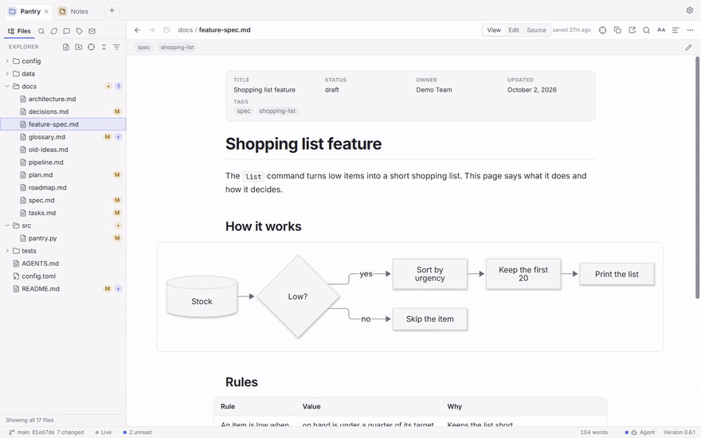
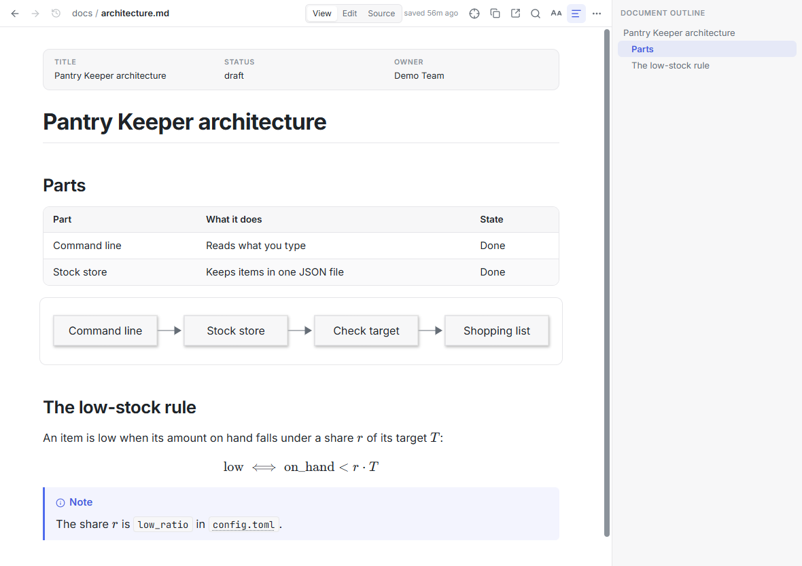
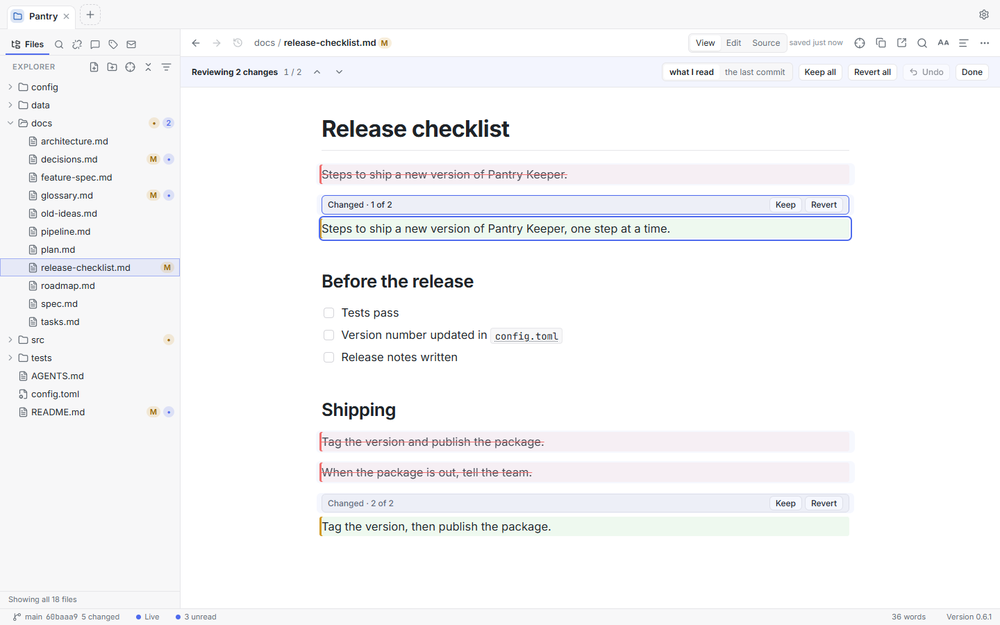
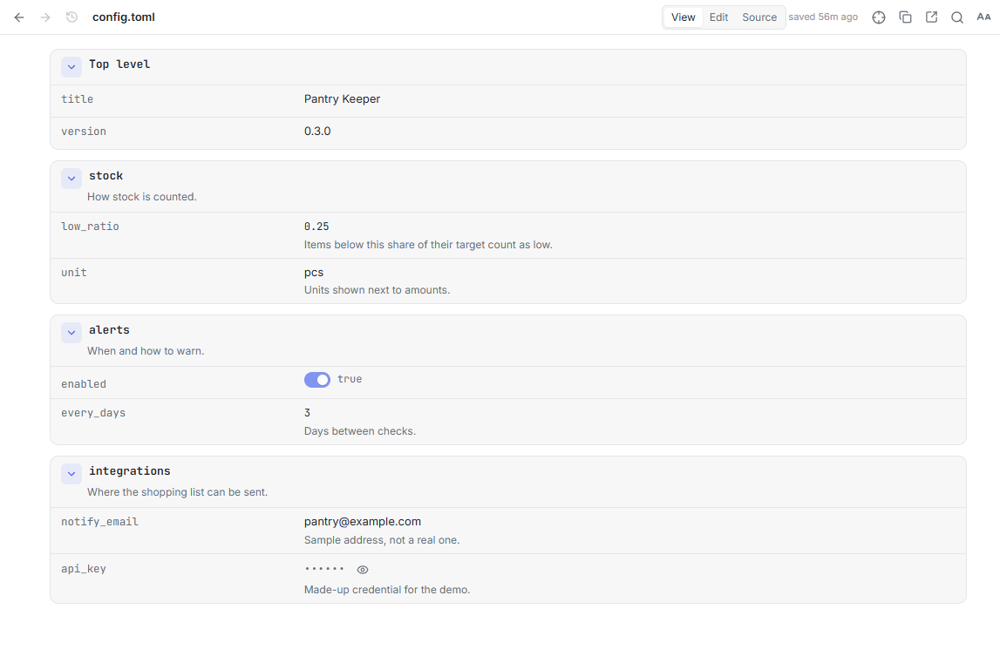
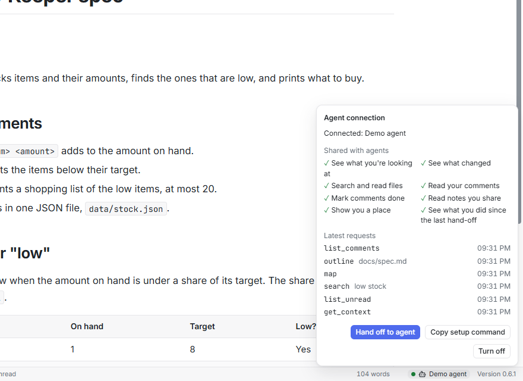

<div align="center">


# PerMark

**AI speeds the work. Your vision steers it.**

A Markdown app to read and review what your AI agents write, and steer the work through its documents.<br>
It opens every Markdown file as a clean page, shows what your agents change while they write, and lets you keep or revert each change.

Created and maintained by [Edelmar Schneider](https://github.com/EdelmarSchneider).

[](https://github.com/EdelmarSchneider/permark/releases/latest)
[](#license)
[](https://github.com/EdelmarSchneider/permark/actions/workflows/ci.yml)

**Get PerMark:** [Microsoft Store](https://apps.microsoft.com/detail/9NVV5GVZMGGX) (Windows) · [GitHub Releases](https://github.com/EdelmarSchneider/permark/releases/latest) (Windows, macOS, Linux)

[Where to start](#where-to-start) · [Try it](#try-it-in-a-minute) · [Install](#install) · [Use with an AI agent](#use-with-an-ai-agent) · [Shortcuts](#keyboard-shortcuts) · [What's new](#whats-new-and-ideas-being-explored) · [Contributing](#contributing)



Free and open source (MIT or Apache-2.0) · No account, no telemetry · Windows, macOS and Linux (tested by hand on Windows)

</div>

---

## Where to start

<table>
<tr><th width="50%">Build with AI agents?</th><th width="50%">Got a .md file?</th></tr>
<tr>
<td valign="top">
<p>Your agents write the plans, specs and reports. Your job is to read them, judge them and steer.
Open the project folder in PerMark and keep it next to your terminal.</p>
<ul>
<li><b>Watch.</b> Changed passages glow while your agent writes, and dots mark what changed since you last read it. <a href="#-see-what-your-ai-writes">See what your AI writes</a></li>
<li><b>Decide.</b> Keep or revert each change, and leave comments an agent can mark done. <a href="#-decide-what-stays">Decide what stays</a></li>
<li><b>Connect.</b> Any MCP agent can see where you are, per project, and only when you turn it on. <a href="#use-with-an-ai-agent">Use with an AI agent</a></li>
</ul>
</td>
<td valign="top">
<p>Your AI, a colleague or a download gives you a <code>.md</code> file.
Open it with PerMark and read it as a page, not a wall of symbols.</p>
<ul>
<li><b>Read it.</b> Tables, diagrams, math and properties on a clean page. Fix it as it looks, and keep notes that save themselves. <a href="#-beautiful-to-read-easy-to-edit">Beautiful to read, easy to edit</a></li>
<li><b>Open what is around it.</b> Config files as sheets, data, pictures, audio and video. <a href="#-markdown-at-the-center-not-alone">Markdown at the center</a></li>
<li><b>Get it.</b> From the Microsoft Store or GitHub, for Windows, macOS and Linux. <a href="#install">Install</a></li>
</ul>
</td>
</tr>
</table>

Either way, PerMark works with any AI tool, or with none. It follows changes whatever program writes the files: an AI agent,
an editor or git. It is a unified document workspace (UDW): Markdown at the center, with the config, data and code files around it.

## Try it in a minute

1. **Install.** Get PerMark from the [Microsoft Store](https://apps.microsoft.com/detail/9NVV5GVZMGGX) or from
   [GitHub Releases](https://github.com/EdelmarSchneider/permark/releases/latest).
2. **Open.** Choose a folder as a project (`Ctrl+O`), or a single `.md` file (`Ctrl+Shift+O`). It opens in View, as a clean page.
3. **Watch.** Let your agent write in that folder. Changed passages glow. Press `Ctrl+Shift+L` for Follow mode, and PerMark opens
   each document while the agent writes it.

## 📖 Beautiful to read, easy to edit

Every Markdown file opens as a clean page, with its tables, diagrams, math and properties. Edit it as it looks, and keep notes
that save themselves.

<picture>
  <source media="(prefers-color-scheme: dark)" srcset="docs/assets/showcase-dark.png">
  
</picture>

- **A clean page.** GitHub-flavored Markdown with tables, task lists, footnotes, alerts and description lists. Code blocks are
  highlighted for about 190 languages. In a project, links open inside the app, with Back and Forward, like a wiki.
- **Diagrams and math, written as text.** Mermaid and PlantUML diagrams are drawn inside PerMark, with no Java and no server.
  Math shows as formulas.
- **Front matter as a properties card.** View shows it as a clean card. In Edit, you change its values one by one, and the rest
  of the file stays as it is.
- **Made for long reading.** A light, dark or system theme, with softer light tones (Paper, Sage, Gray). Three reading widths, an
  outline to jump between sections, and Focus mode (`Ctrl+Alt+F`), which leaves only the page.
- **View, Edit, Source.** One switch in the header. **View** is for reading. **Edit** changes the page as it looks, with a toolbar
  and a `/` block menu. **Source** shows the raw file, every byte, with find and replace and go to line. A switch beside the modes
  draws a Mermaid or PlantUML diagram next to its text while you type (off until you turn it on).
- **Honest about Edit.** Edit keeps math, diagrams, HTML and footnotes as written: **Edit in Source** opens them. Edit does not draw
  pictures that are files next to the document; View and Source do.
- **Notes that save themselves.** Click **Notes**, next to Settings, or press `Ctrl+Shift+N` for a new note from anywhere in PerMark, and type. No name to choose, no folder to pick, no save prompt.
  Notes are plain Markdown files you own, and **Copy** puts a drafted prompt on the clipboard as exact Markdown.

## ⚡ See what your AI writes

See what your AI writes while it writes, and what changed since you last looked.

- **Changed passages glow.** The open document reloads while an agent writes, and keeps your place. Changed blocks glow, and
  removed blocks leave a marker you can expand.
- **Live changes.** A feed lists every file that changed, one entry per file. Show all changes, only yours, or only those from outside.
- **Follow mode** (`Ctrl+Shift+L`) opens the Markdown document being written. It waits while you edit.
- **Unread dots, like mail.** A dot marks each Markdown document that changed since you last read it, and folders count them.
  `Alt+U` opens the next one.
- **Since last visit.** One list of what changed while the project was closed: Changed, New or Removed. It compares the content of
  your documents, so it works without git, and it still shows the changes after the agent has committed.
- **Worktrees too.** Linked git worktrees are found and watched, so agents working in parallel branches show up as well.

PerMark sees the changes in your folder, whatever program makes them. It tells you whether a change came from you or from outside.

## ✅ Decide what stays

You decide what stays: keep or revert each change, comment on any passage, and share a project with an agent only when you turn it on.

<picture>
  <source media="(prefers-color-scheme: dark)" srcset="docs/assets/review-dark.png">
  
</picture>

- **Review, change by change.** When a document changed since you last read it, a quiet bar says how many changes there are.
  **Review** shows each one in place: block by block in Markdown, line by line in code, logs, data and config files. Choose
  **Keep** or **Revert** for each (`K`, `R`), or for all at once. Compare with what you last read, or with the last commit.
- **Comments an agent can mark done.** Select a passage and press `C`. With the agent connection on, your agent reads your open
  comments and marks them done with a reply. **Send to agent** copies them as a prompt for any agent chat. Comments are yours alone.
- **Only what you changed is saved.** Edit and Source rewrite only the blocks you changed. Every other byte stays as its author,
  or agent, wrote it.
- **Reload theirs or Keep mine (overwrite).** If an agent changes a file while you edit it, you choose, for the whole document.
- **Git in plain words.** Letter badges, with a legend that says what each letter means. Compare with your last visit or with
  the last commit. PerMark only reads git: it never commits, stages or creates a repository.
- **Find anything, to the section.** **Search everywhere** (`Ctrl+T`) finds files, sections, tags and commands in one box. Give any
  file tags and a one-line description; the ones you add in the app never touch your files.
- **Links follow your files.** Move or rename a file, and PerMark shows each link it will update before it changes them.
  `Ctrl+Z` in the Explorer takes it back.

## 🧩 Markdown at the center, not alone

Markdown leads, and many files around it open too: config files as clean sheets, data and code, pictures, audio and video.

<picture>
  <source media="(prefers-color-scheme: dark)" srcset="docs/assets/config-sheet-dark.png">
  
</picture>

- **Config files as clean sheets.** TOML, YAML, INI, `.env`, `.properties` and ignore files open as sections, keys and values,
  with comments as captions. Change a value, and only those bytes change.
  Sheets edit values, not keys. YAML flow style is read-only, and a file over 256 KB or 3,000 rows shows as plain text.
- **TOON.** `.toon` files, the compact data format made for AI, open as tables and cards and can be edited in place. The
  **Converter** turns JSON, XML, YAML, CSV and TOML into TOON or another format, shows the estimated token saving of each choice,
  and never writes over the original.
- **AI files, recognized.** `AGENTS.md`, `CLAUDE.md`, `SKILL.md`, Cursor rules (`.mdc`), `llms.txt`, prompt files, and model and
  dataset cards open with no setup.
- **Prompt blocks.** XML-like prompt tags such as `<context>` and `<instructions>` fold as blocks, and the Markdown inside still renders.
  `{{name}}` variables are marked, and `@path` references link to the file.
- **JSON, XML, code and plain text** open with highlighting. A very large text file opens at once.
- **Pictures, audio and video** open in the app (not every audio or video format plays). Other files open with the program your
  system has for them. Programs and scripts are never run from a click.
- **Token count**: how many tokens a document, a section or a folder takes. Exact for OpenAI's tokenizers,
  marked as approximate for Claude and Gemini. It asks before it downloads a tokenizer's vocabulary.
- **Your editor, at the line.** A path like `src/main.rs:42` that names a file of the project is a link: it opens your own
  editor at that line.

Many features are plugins, and every plugin is on from the start. Turn off what you do not need in **Settings → Plugins**; a plugin that is off leaves nothing behind.

## Questions people ask

**"Git diff already shows me the changes."**<br>
Git diff compares with the last commit. PerMark also shows what changed since you last read each document, even after the agent
has committed, and you keep or revert each change.

**"Does it replace my code editor?"**<br>
No. PerMark is for the documents around the code. **Open in external editor** takes you to your own editor at the place you are reading.

**"What does the agent get, and how do I stop it?"**<br>
Sharing is off in every project until you turn it on. The agent reads, shows you a place and marks comments done. It never edits
through PerMark. Details in [Use with an AI agent](#use-with-an-ai-agent).

**"Does it go online?"**<br>
No account, no telemetry, no tracking. PerMark goes online only to check for its own updates (installer versions; the Store and
snap update it instead), and when you ask: a picture from the web, or the optional token-count vocabulary. Your documents never
leave your computer through PerMark. An AI agent you connect is a separate program: what it sends online is up to that agent.
The Windows installers may also download Microsoft's WebView2 component while they install, if your computer does not have it.

## What PerMark is not

- **Not a code editor.** No completion, refactoring, build, run or debug. Real code work opens in your own editor.
- **Not an agent.** It does not run, host or replace your AI. It shows what your AI writes, and you decide what stays.
- **Not tested by hand on macOS or Linux.** PerMark 0.6 was tested by hand on Windows; the macOS and Linux builds are checked automatically.

## Why Markdown

**Markdown was made for readers. So is PerMark.** It was designed in 2004 so that plain text reads well as it is. Today, AI
tools write it too, for the same reason: it is structured enough for a machine and clear enough for a person.

It is also an opinion: many documents that live in Word or PDF today would be better as Markdown. They would be smaller,
comparable line by line in git, readable by any AI, and never locked inside one app.

## Install

Windows, macOS and Linux. PerMark 0.6 was tested by hand on Windows; the macOS and Linux builds are checked automatically.
Installers are not code-signed, so your system shows a warning the first time you install or open it.

| System | Get it |
|---|---|
| Windows | The [Microsoft Store](https://apps.microsoft.com/detail/9NVV5GVZMGGX), which keeps PerMark up to date. Or the `-setup.exe` from [Releases](https://github.com/EdelmarSchneider/permark/releases/latest); the `.msi` is only for updating copies installed from a 0.5 `.msi` |
| macOS | The universal `.dmg` (Apple silicon and Intel) from [Releases](https://github.com/EdelmarSchneider/permark/releases/latest) |
| Linux | The `.AppImage`, `.deb` or `.rpm` from [Releases](https://github.com/EdelmarSchneider/permark/releases/latest), or the snap (64-bit Intel and AMD): `sudo snap install permark` |

Copies from GitHub check for updates when they start and once a day, and offer to download and restart. The Microsoft Store and the snap update their copies themselves.
PerMark becomes your default app for Markdown only if you choose it: it asks once, with Markdown files checked and other types
unchecked. On Windows, you confirm the choice in Windows Settings.

**Coming from TrailMark?** The command is now `permark`. If an agent is set up with the old `trailmark` command, run the setup
lines from **Settings → Integration → Agent connection** again. PerMark 0.6 no longer renames old `.trailmark/` folders: update
to 0.5.8 before you update to 0.6.

<details>
<summary><b>Command line</b></summary>

```bash
permark                  # start PerMark: your last windows and tabs come back
permark .                # open the current folder as a project
permark docs/plan.md     # open a single file
permark --notes          # open the Notes
```

On Windows and macOS, `permark` is not on your `PATH` after an install from GitHub, so use the full path of the program, or add
it yourself. The Microsoft Store and snap versions put `permark` on your `PATH`.

</details>

<details>
<summary><b>Build from source</b></summary>

You need [Rust](https://rustup.rs), [Node.js](https://nodejs.org) 24 and the
[Tauri prerequisites](https://v2.tauri.app/start/prerequisites/). The program lives in `app/`, and `app/rust-toolchain.toml` pins
the Rust version, which `rustup` installs for you.

```bash
git clone https://github.com/EdelmarSchneider/permark.git
cd permark/app
npm ci
npm run tauri build   # or: npm run tauri dev
```

</details>

## Use with an AI agent

PerMark can tell an AI agent what you are looking at, the way a code editor tells it the open file. Say "rewrite this paragraph"
or "go through my comments", and the agent knows which document, which section and which words you mean. It works with any tool
that speaks the [Model Context Protocol](https://modelcontextprotocol.io) (MCP).

**What it shares, and how it stays in your hands:**

- **Off until you turn it on, per project.** Choose **Share this project with agents** in **Settings → Integration → Agent connection**,
  or run **Agent connection: turn on** from the command palette. Nothing inside a project can turn it on.
- **Local.** It talks only to programs on your computer and opens no network port.
- **Read, never edit.** The agent sees where you are, what you selected, what changed, your comments and the notes you shared one
  by one. It reads, shows you a place and marks comments done. It never edits a file through PerMark.
- **Your limits.** You choose what it may do, group by group. Files in `.aiignore` never reach an agent; everything else it reads
  as written, passwords and keys included, so list files with secrets in `.aiignore`.
- **Visible.** While the connection is on, the status bar shows **Agent**. Click it to see what is shared and the latest requests.

<picture>
  <source media="(prefers-color-scheme: dark)" srcset="docs/assets/agent-dark.png">
  
</picture>

**Connect in two lines.** Turn the connection on, then add PerMark to your agent as an MCP server. **Settings → Integration →
Agent connection** shows these lines with the right path for your copy, and a Copy button.

```bash
# Claude Code
claude mcp add permark -- "<path to PerMark>" mcp
```

```json
{ "mcpServers": { "permark": { "command": "<path to PerMark>", "args": ["mcp"] } } }
```

The second form fits any other MCP client. With the connection on, **Hand off to agent** copies one line for your prompt, so the
agent asks PerMark what you did instead of rereading the project.

<details>
<summary><b>What an agent can do: the 13 tools</b></summary>

| Tool | What it answers or does |
|---|---|
| `get_context` | The open document, whether you are reading or editing, the section on screen, your selection (up to 2,000 characters), whether there are unsaved edits, and how many of your comments are open |
| `list_unread` | The documents that changed since you last read them, the newest at the top |
| `map` | The files below a folder, by path: approximate size in tokens, flags (unread, changed), and the tags and descriptions you gave them. The place to start in a large project |
| `search` | "Where is X described?": ranked sections with path, line, size, snippet and heading, from the same index as Search everywhere. `tags` narrows the search, and `budget` caps the size of the answer |
| `list_tags` | The tags in use, with how many documents have each; or, for one tag, the documents that have it with their descriptions |
| `outline` | The parts of one file (headings, JSON keys, parts of a config file) with line ranges and sizes, so an agent reads only the part it needs; optionally the links in and out |
| `read` | The text of one part of a file: a heading, an anchor, a key path or a range of lines. Long parts continue with a cursor |
| `list_comments` | Your open comments, each with the quoted passage, its section and line, and your text |
| `resolve_comment` | Marks a comment done, with an optional short reply that you read under the comment |
| `list_notes` | The notes you chose to share with agents, each with its title, when it changed and its size |
| `read_note` | The text of one shared note, by the name `list_notes` gave |
| `activity` | What you did in PerMark since you last pressed **Hand off to agent** (checked against the disk), plus the changes made outside PerMark |
| `open` | Shows you a place (a document, a line or a heading) without taking the focus from the agent's terminal, and offers a way back |

Answers are short on purpose: a header line, then tab-separated rows, so an agent spends few tokens. A project's `.permark/` folder
can narrow what an agent may do, never widen it. When PerMark is closed, the other tools still work from the files, and `open`
starts it. With the connection off, every tool says so and explains how to turn it on.

</details>

<details>
<summary><b>Add what you are reading to every prompt: <code>permark context</code></b></summary>

`permark context` prints where you are as one short line and exits, for tools that can run a command before each prompt:

```text
Viewing docs/plan.md › Plan › Rollout (lines 40-62), selected (lines 44-46): 'ship it on Friday', 2 comments open.
```

In Claude Code, a `UserPromptSubmit` hook in `.claude/settings.json` (or your user settings) adds it to every prompt:

```json
{
  "hooks": {
    "UserPromptSubmit": [
      { "hooks": [{ "type": "command", "command": "\"<path to PerMark>\" context" }] }
    ]
  }
}
```

When there is nothing to say (the connection is off, or PerMark is not open), the command prints nothing, so a hook never adds
noise to a prompt. A project with a `.permark/` folder also has `.permark/local/agent-context.json` while the connection is on:
the same answer as a file, for a script or a tool without MCP. **It holds the open document, the section on screen and your
selected text, and any program running as you can read it, as can a folder-sync tool that watches the project.** It stays out of git and is deleted when the connection is turned off.

</details>

## Keyboard shortcuts

The ten that matter most. On macOS, use `Cmd` where this README says `Ctrl` (except `Ctrl+Tab` and `Ctrl+Shift+Tab`).

| Action | Shortcut |
|---|---|
| Search everywhere (files, sections, tags, commands) | `Ctrl+T` |
| Quick open a file | `Ctrl+P` |
| Every command | `Ctrl+Shift+P` |
| Next unread document | `Alt+U` |
| Follow mode | `Ctrl+Shift+L` |
| Next / previous change | `F7` / `Shift+F7` |
| While you review: keep / revert | `K` / `R` |
| Comment on the selected passage | `C` |
| Edit, and back to View | `Ctrl+E` |
| Focus mode: only the page | `Ctrl+Alt+F` |

All of them, and you can change them, in **Settings → Keyboard shortcuts**.

<details>
<summary><b>All default shortcuts</b></summary>

**Reading and navigating**

| Action | Shortcut |
|---|---|
| Search all docs (by section) | `Ctrl+Shift+F` |
| Find in page | `Ctrl+F` |
| Show / hide the outline | `Ctrl+Alt+O` |
| Show / hide the sidebar (when you are not editing) / the right panel | `Ctrl+B` / `Ctrl+Alt+B` |
| Cycle the reading width | `Ctrl+Alt+W` |
| Back / forward | `Alt+←` / `Alt+→` |
| Copy reference (or selection with reference) | `Ctrl+Alt+C` |
| Copy the whole document (View and Source) | `Ctrl+Shift+C` |
| Open in your external editor | `Ctrl+Shift+E` |
| Zoom in / out / reset | `Ctrl+=` / `Ctrl+-` / `Ctrl+0` |
| Open a folder / a file | `Ctrl+O` / `Ctrl+Shift+O` |
| Settings | `Ctrl+,` |
| Edit the open document's tags and description | `T` |

**Tabs**

| Action | Shortcut |
|---|---|
| Next / previous tab | `Ctrl+Tab` / `Ctrl+Shift+Tab` (or `Ctrl+Alt+→` / `Ctrl+Alt+←`) |
| Go to tab 1 to 8 / the last tab | `Ctrl+1` … `Ctrl+8` / `Ctrl+9` |
| Close the tab | `Ctrl+W` |

**Review**

| Action | Shortcut |
|---|---|
| Keep / revert this change | `K` / `R` |
| Next / previous change | `N` / `P` |
| Keep all / revert all | `Shift+K` / `Shift+R` |

**Editing**

| Action | Shortcut |
|---|---|
| Open Source mode | `Ctrl+Alt+E` |
| Back to View | `Ctrl+E` or `Esc` |
| Save | `Ctrl+S` |
| New file | `Ctrl+N` |
| Bold / italic / strikethrough (Edit) | `Ctrl+B` / `Ctrl+I` / `Ctrl+Shift+X` |
| Bold (Source, in Markdown files) | `Ctrl+B` |
| Link / inline code (Edit) | `Ctrl+K` / `Ctrl+Shift+C` |
| Headings 1 to 6 (Edit) | `Ctrl+Shift+1` … `6` |
| Paragraph (Edit) | `Ctrl+Alt+0` |
| Block menu (Edit) | `/` in an empty paragraph |
| Find / replace / go to line (Source) | `Ctrl+F` / `Ctrl+H` / `Ctrl+G` |

**Notes and the Explorer**

| Action | Shortcut |
|---|---|
| Open the Notes | `Ctrl+Shift+D` |
| New note, from anywhere in PerMark | `Ctrl+Shift+N` |
| New note (in Notes) | `Ctrl+N` |
| Copy the note's text (in Notes) | `Ctrl+Shift+C` |
| Open a pinned note (in Notes) | `Ctrl+1` … `Ctrl+9` |
| Rename / delete (to the system trash) | `F2` / `Del` |
| Take back the last file operation (on macOS, a deleted file stays in the Trash) | `Ctrl+Z` |

</details>

## What's new and ideas being explored

**PerMark 0.6** rebuilt the whole program. Every release is in the [CHANGELOG](CHANGELOG.md).

- **0.6.2:** a Notes button next to Settings, keys to hide and show the side bars, files dropped from your file manager copy into the project or open as
  tabs, **Move to window** for a tab, and every plugin on from the start.
- **0.6.1:** every folder, file and Notes gets a tab, and your windows and tabs come back when PerMark starts.
- **0.6.0:** many windows in one app, a full Settings page, a Plugins page and keys you can change.
- Config files and TOON as clean sheets, AI files recognized with no setup, and prompt blocks.
- Review of code and text files, line by line, with keep or revert.
- An agent connection with 13 tools, permission groups, `.aiignore` and **Hand off to agent**.

**Ideas being explored, no promises:** a home for structured work with AI, such as spec-driven development, for the projects that
want it; ready-made ways of working to adopt, such as Spec Kit templates; and a shared place where people and always-on agents
follow and review the work together, with the person in charge.

## Tech

PerMark is a [Tauri 2](https://v2.tauri.app) app. The core is written in **Rust**: rendering (comrak and ammonia), file watching
(notify), git (the one on your computer, or a built-in libgit2 when there is none), the search index and the block-preserving saves.
The interface is **Svelte 5** and TypeScript in the system webview, with **CodeMirror 6** (Source) and **Milkdown** (Edit).

## Contributing

Issues and pull requests are welcome. The project uses **git-flow** (`develop` for integration, `feature/*` branches) and a strict
quality gate:

```bash
cd app
npm run check   # version, rustfmt, prettier, build, clippy -D warnings, svelte-check, cargo test, vitest
```

See [CONTRIBUTING.md](CONTRIBUTING.md) before opening a pull request. It also explains how to fix or add a translation.

## License

Copyright (c) 2026 Edelmar Schneider. Licensed under either of [MIT](LICENSE-MIT) or [Apache-2.0](LICENSE-APACHE), at your option.

"PerMark" and its logo are trademarks of Edelmar Schneider: forks are welcome under a different name. See [TRADEMARKS.md](TRADEMARKS.md).
