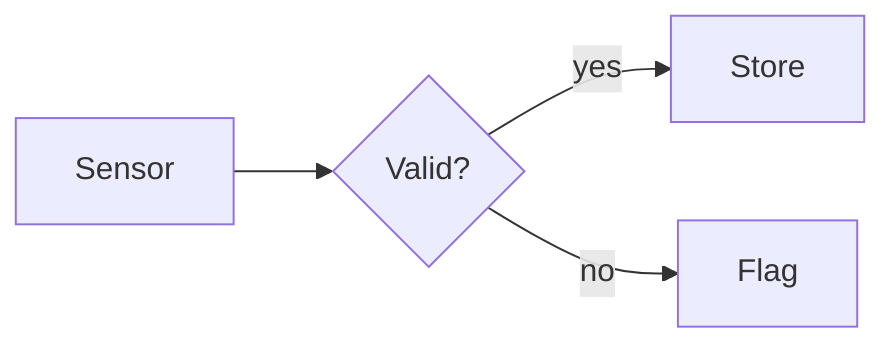
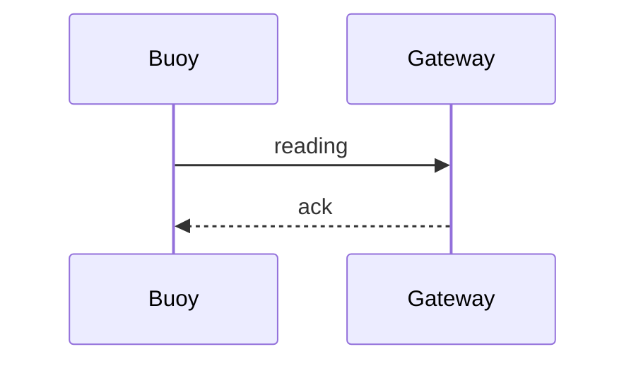
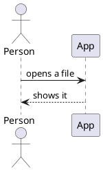
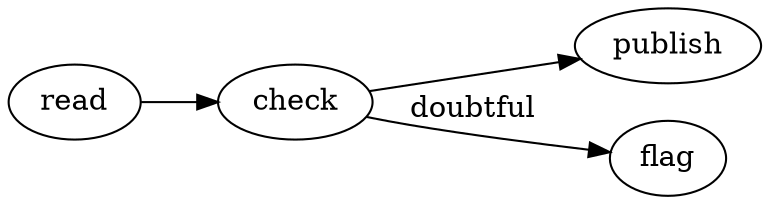

# Diagrams





A Mermaid diagram with a syntax error:

```mermaid
flowchart LR
  A[Open bracket --> B
  this is not mermaid ((
```



A PlantUML diagram with a syntax error:

```plantuml
@startuml
this is -> -> not valid ::: plantuml
@enduml
```



A Graphviz diagram with a syntax error:

```dot
digraph G {
  a -> ;
  }}}
```
