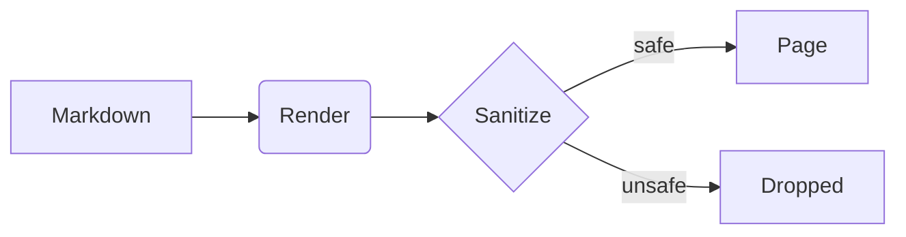

# Reading showcase

A page of everything the reading view draws. It links to the [guide](docs/guide.md), to a [missing page](docs/nope.md) and to [a section](#diagrams). Code references open in your editor: `src/main.rs:12`, and plain text like src/main.rs:3 works too.

## Text and lists

Paragraphs keep a comfortable measure at **any** zoom: *emphasis*, `inline code`, ~~strike~~, a footnote[^1] and an autolink https://example.com. Press <kbd>Ctrl</kbd>+<kbd>F</kbd> to find in page.

- [x] Render Markdown
- [x] Keep my place when the file changes
- [ ] Review the changes

1. First
2. Second
   - nested item
   - another one

> [!NOTE]
> Alerts come with a title and an icon.

> [!WARNING]
> Reading is the main mode. Beautiful, clear reading is a requirement.

## Code

```rust
fn main() {
    let name = "PerMark";
    println!("Hello, {name}!");
}
```

```json
{ "name": "permark", "private": true, "version": "0.6.0" }
```

## Tables

| Feature  | Status  | Notes                         |
| -------- | ------- | ----------------------------- |
| Tables   | done    | Zebra rows, sticky header     |
| Math     | done    | KaTeX, loaded when needed     |
| Diagrams | done    | Mermaid and PlantUML in page  |

## Math

Inline math $E = mc^2$ sits in the text. A display formula:

$$
\int_0^\infty e^{-x^2}\,dx = \frac{\sqrt{\pi}}{2}
$$

## Diagrams



## Prompt blocks

<context>
You are reading a prompt file. The tags below fold, and **Markdown inside them** still renders.

- Variables look like {{customer_name}} and are marked.
- Files are linked: see @docs/guide.md for the guide.
</context>

<instructions>
1. Be brief.
2. Quote the source.
</instructions>

[^1]: Footnotes list at the end of the page, with a way back.
