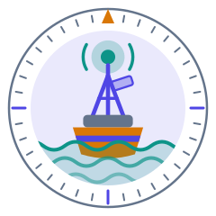
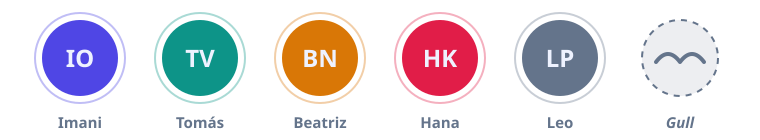

  

<h1 align="center">Tidewell Field Notes</h1>

<em>Twelve buoys, one small lab, and every page a plain Markdown file.</em>

  <a href="field-journal.md"><strong>Start reading</strong></a> · <a href="station-architecture.md">Diagrams</a> · <a href="ocean-chemistry.md">Math</a> · <a href="tidewell-api.md">API</a> · <a href="season-plan.md">Plan</a> · <a href="bulletin-agent.md">Prompts</a>

## Welcome aboard

Larkhaven Marine Lab runs Tidewell: twelve solar buoys on Larkhaven Sound that measure temperature, salinity, pH, dissolved oxygen and waves every ten minutes, and publish all of it as open data. This folder is the lab's notebook: the voyage that put Season 3 in the water, the science behind the numbers, the API, the plan and the people.

It is also a sample project for PerMark. Every page here is a plain Markdown file you could open in any text editor. The diagrams, formulas, callouts and tables you're about to see are all written as text.

> [!TIP] This folder is yours
> Edit any page, break it, delete it. Nothing here is precious, and PerMark only ever saves the parts you change.

## The tour

Ten pages, each one a real document from the lab, and each showing off something different.

|   | Page | What you'll see |
|:-:|------|-----------------|
| :sailboat: | [Nine Days on the Petrel](field-journal.md) | A voyage journal with a map, footnotes, a sound clip and a letter in Portuguese |
| :satellite: | [How a reading travels](station-architecture.md) | Flowchart, sequence, timing and state diagrams, all written as text |
| :electric_plug: | [Tidewell Open Data API](tidewell-api.md) | An API reference with titled code, highlighted lines and a version timeline |
| :test_tube: | [Carbon in the Sound](ocean-chemistry.md) | Chemical equations and wave physics, typeset |
| :bar_chart: | [Ninety days of Sound data](data-notebook.md) | Charts, a flow of 155,520 readings and a wide table that scrolls |
| :calendar: | [Season 3 deployment plan](season-plan.md) | A Gantt chart, a risk quadrant, the budget and task lists |
| :bird: | [Gull: the weekly bulletin agent](bulletin-agent.md) | A prompt file with foldable blocks and marked variables |
| :pencil2: | [How we write](style-guide.md) | Every callout and small mark, with the source beside it |
| :compass: | [Working in PerMark](permark-guide.md) | A ten-minute tour of reading, editing, review and sharing |
| :stew: | [Moqueca for twelve](galley-recipe.md) | The stew that fed the crew, scaled from four servings to twelve |

## The crew

Five people and one patient agent keep Tidewell afloat.

Dr. Imani Okafor
: Lab director and chemical oceanographer. Keeps the science honest and the [style guide](style-guide.md) short.

Tomás Varela
: Platform lead. Built the path from buoy to [API](tidewell-api.md), one 40-second wake at a time.

Beatriz Nogueira
: Field technician and skipper of the research boat *Petrel*. Writes the [journal](field-journal.md) and cooks the [moqueca](galley-recipe.md).

Hana Kowalski
: Program manager and volunteer coordinator. Owns the [season plan](season-plan.md) and the [PerMark guide](permark-guide.md).

Leo Park
: Data scientist. Turns readings into the [data notebook](data-notebook.md) and taught Gull to write.

Gull
: The lab's read-only agent. Drafts the weekly [bulletin](bulletin-agent.md); a person always signs it off.

## Find your way

Press <kbd>Ctrl</kbd>+<kbd>P</kbd> to jump to any page by name, or <kbd>Ctrl</kbd>+<kbd>Shift</kbd>+<kbd>F</kbd> to search all of them at once. On a long page, <kbd>Ctrl</kbd>+<kbd>Alt</kbd>+<kbd>O</kbd> opens the outline, so you can skip straight to the section you want. On macOS, press <kbd>Cmd</kbd> where you see Ctrl, and <kbd>Option</kbd> for Alt.

New here? The [ten-minute tour](permark-guide.md) covers the rest.

---

Larkhaven Marine Lab, Tidewell and everyone in these pages are fictional. [Back to top](#top)
