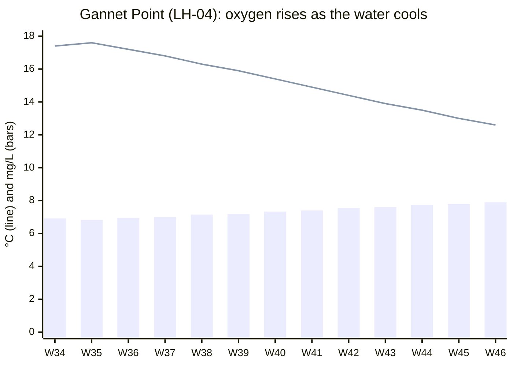
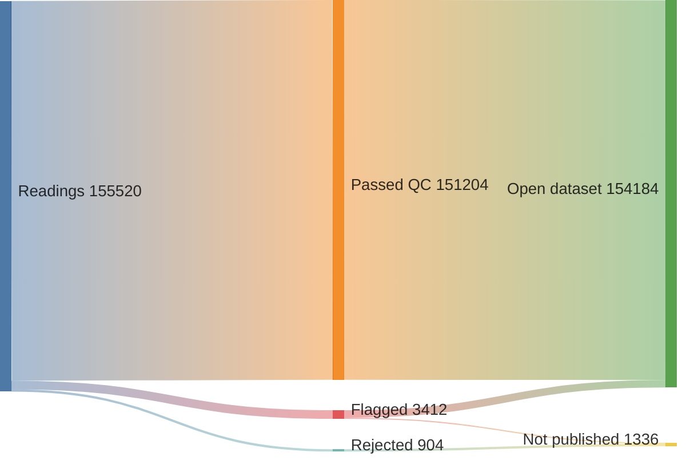
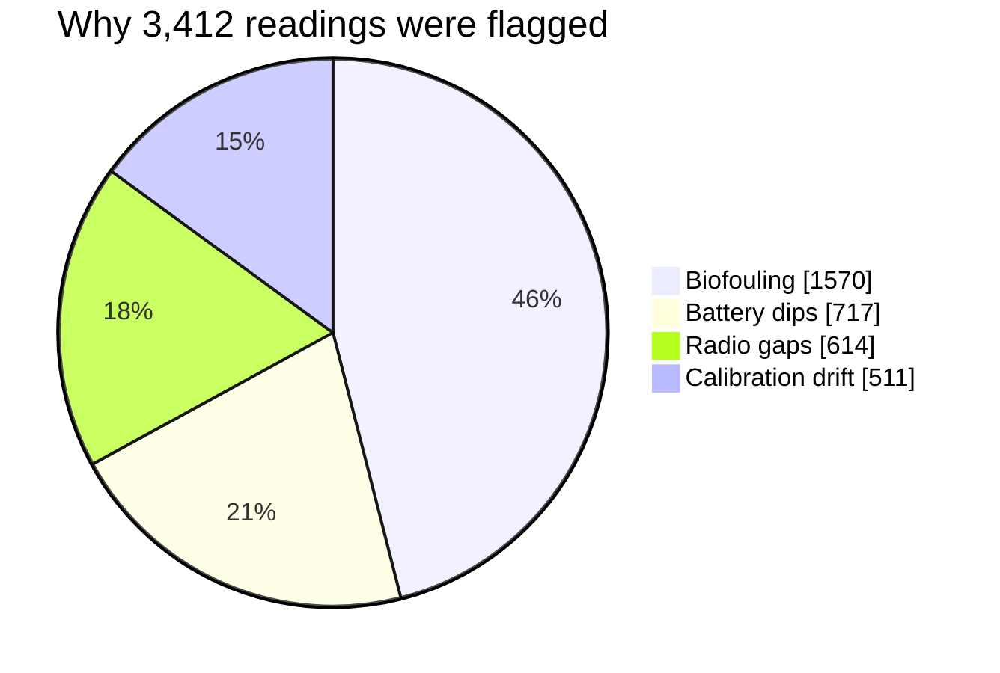
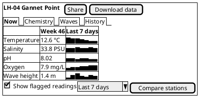

# Ninety days of Sound data

From August 17 to November 14, our twelve buoys sent 155,520 readings. This notebook follows them through quality control and asks one question: how closely does oxygen follow temperature?



## The short version

> [!abstract] Three things to know
> - 97.2 % of readings passed quality control, and 2,980 more are published with a flag.
> - Across all stations, daily oxygen drops by 0.21 mg/L for every degree of warming ($r = -0.81$).
> - The pH sensor at Kittiwake Shoal is starting to drift, and QC warned us before any reading needed a flag.

## Where 155,520 readings went

Every reading passes through the QC engine, which applies the range, spike, flatline and drift rules in [`station/qc-rules.yaml`](station/qc-rules.yaml). Most pass untouched. Flagged readings get a human look: if we understand the cause and the value is still useful, it stays in the open dataset with its flag.



In numbers: 151,204 passed (97.2 %); 3,412 were flagged, of which 2,980 are published with their flag and 432 were removed after review; 904 were rejected outright. The open dataset holds 154,184 readings.

## Temperature against oxygen

Cold water holds more dissolved oxygen (O<sub>2</sub>), so we expected the two to move in opposite directions. To measure how tightly, we took daily means for each station and computed Pearson's correlation coefficient:

\[
r = \frac{\sum_i (x_i-\bar x)(y_i-\bar y)}{\sqrt{\sum_i (x_i-\bar x)^2}\,\sqrt{\sum_i (y_i-\bar y)^2}}
\]

With $x$ the daily mean temperature and $y$ the daily mean oxygen over 1,074 station-days, $r = -0.81$ and R<sup>2</sup> = 0.66: temperature alone explains about two thirds of the variation. The fitted slope is −0.21 mg/L per °C, a little steeper than solubility alone predicts (about −0.17 mg/L per °C at these temperatures, see [Oxygen and temperature](ocean-chemistry.md#oxygen-and-temperature)). The difference is biology: warm water also speeds up the bacteria that use oxygen.

## The code

The whole analysis fits in a dozen lines of pandas. Lines 6 to 9 do the work: group by station and day, keep the full days, correlate, fit a straight line.

```python title="notebooks/do_vs_temp.py" {6-9}
import numpy as np
import pandas as pd

df = pd.read_parquet("data/tidewell-90d.parquet")  # passed + flagged readings
df["day"] = df["time"].dt.date
g = df.groupby(["station", "day"])[["temp_c", "do_mgl"]]
daily = g.mean()[g.size() >= 120].dropna()  # 120+ of 144 readings
r = daily["temp_c"].corr(daily["do_mgl"])  # Pearson is the default
slope, intercept = np.polyfit(daily["temp_c"], daily["do_mgl"], deg=1)

print(f"r = {r:.2f}  R² = {r * r:.2f}  slope = {slope:.2f} mg/L per °C")
```

## Station by station

Ninety-day means for every station. The table is wider than the page, so scroll it sideways; "On time" counts readings that arrived within their ten-minute cycle, and the rest were sent later from the buoy's memory.

| Station | Name | Passed % | On time % | Mean T °C | Mean S PSU | Mean pH | Mean DO mg/L | Flags | Battery V |
|---|---|---:|---:|---:|---:|---:|---:|---:|---:|
| LH-01 | — | 97.9 | 99.6 | 15.4 | 33.7 | 8.04 | 7.31 | 214 | 13.1 |
| LH-02 | — | 98.2 | 99.7 | 15.2 | 33.9 | 8.05 | 7.36 | 188 | 13.2 |
| LH-03 | — | 97.7 | 99.4 | 15.6 | 33.5 | 8.03 | 7.27 | 236 | 13.0 |
| LH-04 | Gannet Point | 97.7 | 99.5 | 15.1 | 33.6 | 8.03 | 7.38 | 251 | 13.1 |
| LH-05 | — | 98.3 | 99.8 | 14.8 | 34.0 | 8.05 | 7.44 | 173 | 13.2 |
| LH-06 | — | 97.9 | 99.3 | 15.0 | 33.8 | 8.04 | 7.40 | 205 | 13.0 |
| LH-07 | Kittiwake Shoal | 93.3 | 98.9 | 14.2 | 34.2 | 8.08 | 7.57 | 742 | 12.9 |
| LH-08 | — | 98.1 | 99.6 | 14.6 | 34.1 | 8.05 | 7.49 | 196 | 13.1 |
| LH-09 | — | 97.1 | 98.2 | 15.3 | 33.4 | 8.02 | 7.33 | 287 | 12.7 |
| LH-10 | — | 98.2 | 99.5 | 14.9 | 33.9 | 8.04 | 7.42 | 182 | 13.2 |
| LH-11 | Heron Flats | 94.3 | 96.4 | 15.9 | 31.8 | 7.98 | 7.12 | 548 | 12.6 |
| LH-12 | — | 98.1 | 99.7 | 14.7 | 34.0 | 8.05 | 7.47 | 190 | 13.1 |
| **All** | | **97.2** | **99.1** | **15.1** | **33.7** | **8.04** | **7.38** | **3,412** | **13.0** |

## Where the flags came from

Biofouling leads, as it does every autumn: algae and barnacles on the sensor cage slowly cut the oxygen and pH sensors off from fresh water. Heron Flats, shallow and warm all summer, fouled fastest.



## Drift at Kittiwake Shoal

> [!bug] The pH at LH-07 is sliding
> In early November, pH at Kittiwake Shoal began to fall faster than the water around it^[The neighbors are LH-06 and LH-08, the two stations closest to the shoal. Their week-46 means were 8.00 and 7.99, against 7.96 at LH-07.]. On November 12 the trend reached −0.008 a day against the station's own 14-day median, 80 % of the drift limit, and the QC engine logged a warning (see the [ingest log](station/ingest-2026-11-12.log)). Nothing is flagged yet: Beatriz will check the sensor against a water sample before winter maintenance starts on December 1.

## What we build next

Readers asked for one card per station instead of a spreadsheet. This is the wireframe we are testing, drawn as plain text:



## Method notes

> [!info]- Method notes
> - Times are UTC. A daily mean needs at least 120 of the day's 144 readings; 6 of the 1,080 station-days fell short.
> - Oxygen is measured optically as dissolved $\ce{O2}$ and corrected for salinity before it reaches the API.
> - Correlations use the open dataset only: readings that passed, plus flagged readings we kept.
> - Weeks are ISO weeks. Week 46 runs November 9 to 15, so it has six days in this dataset.

---

Next: [Season 3 deployment plan](season-plan.md) · [Start here](README.md)
