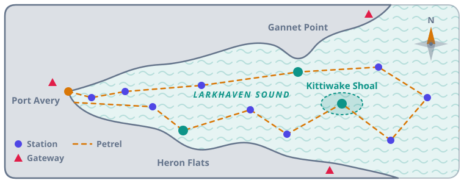

# Nine Days on the Petrel

*Twelve new buoys, one small boat, nine days on Larkhaven Sound: the voyage that started Season 3, October 12 to 20.*

  

<em>The Petrel's track: out from Port Avery along the north shore, around the outer stations, home by Heron Flats.</em>

## Day 1 — Port Avery, before dawn

> *"Mar en calma nunca hizo buen marinero."*\
> A calm sea never made a good sailor.\
> — Joaquín, skipper of our partner boat, on the dock at five in the morning

We cast off at 05:40 with twelve new buoys lashed along the deck in two rows of six. Aboard: Imani, Tomás, two volunteers from Port Avery, and me at the wheel. Hana waved from the pier with a thermos in each hand and the [season plan](season-plan.md) folded in her pocket.

This season we're not adding stations, we're replacing them. Each new buoy goes in beside the old one, both report side by side for an hour, and only then does the old one come aboard. Day 1 is for the winch, the A-frame and the reference casts, so the new sensors have something true to be compared with.

## Day 3 — The first buoy goes in

The new LH-01 went over the side at 09:30, eleven minutes after we reached its mark. Tomás counted down the release, the mooring line paid out, and for a moment nobody said anything at all.

==At 09:42 its first reading reached the Avery Pier gateway: 13.9 °C, 33.1 PSU.==

Imani lowered the <abbr title="conductivity, temperature, depth">CTD</abbr> beside it for a reference cast,[^cast] and the two agreed to the second decimal. The old LH-01 came aboard at 10:45, furred with weed. By sunset LH-02 and LH-05 were swapped too.

## Day 5 — Weather

The forecast promised a fresh breeze. By noon it was a strong one, Beaufort 6,^[Beaufort 6 is a strong breeze: 22 to 27 knots, large waves forming, white foam crests almost everywhere.] and we ran back to the lee of Gannet Point, where we'd swapped LH-04 the day before, to wait it out. The swell found us anyway.

---

Nobody slept much. The old buoys in the hold knocked against their straps all night, and the *Petrel* earned her name.[^petrel] Around two in the morning the wind dropped as fast as it had come, and by breakfast we were laughing about it.

> [!quote] Overheard in the galley
> "The buoys don't mind the weather. They were built for it. We're the ones who need soup."\
> — Tomás

## Day 7 — Kittiwake Shoal

Kittiwake Shoal[^kittiwake] is the reason we have a pH budget at all. Twice a day the tide pushes deeper water up over the shoal, carrying more dissolved CO2, and Imani wants to watch the pH dip when it does. Her page on [carbon in the Sound](ocean-chemistry.md) explains why that matters for every shell in the bay.

We swapped LH-07 at slack water. Then we dropped the hydrophone over the side to listen to the new mooring settle, and caught something else: the bell on the shoal marker, rocking in the swell.

<audio controls src="assets/hydrophone-bell.wav"></audio>

*Two seconds from the hydrophone, three meters down: the shoal's channel bell.*

## Day 9 — Home

We saved the inner stations for last, so the old buoys would ride home the shortest way. LH-03 went in late on Day 8, and on Day 9 we tied up at Avery Pier at 14:10 with a deck full of tired old buoys and not one new one left.

Hana was on the pier again. Leo had the dashboard open on his phone and turned it around so we could see: twelve stations, twelve green dots, every one reporting on the new firmware, 3.2.0. The moqueca that kept us going all week is in [the galley](galley-recipe.md).

## A letter home

I wrote to my grandmother on the last night out. She doesn't read English, so this part is in Portuguese; the translation is folded below.

Querida vó Lurdes,

Escrevo do convés do *Petrel*, com a caneca de café equilibrada no joelho. As doze boias novas já estão no mar, uma para cada mês do ano, como a senhora disse quando contei o plano.

Na sexta o vento virou e passamos a noite inteira subindo e descendo ondas, mas ninguém enjoou, nem o Tomás, que jurava que ia enjoar. Hoje o mar amanheceu liso como lençol passado.

Toda vez que uma boia acende a luz no mastro, eu lembro da lamparina na sua cozinha em Ilhéus. Fiz a sua moqueca para a tripulação e não sobrou nem o arroz.

Volto para casa na terça, com sal no cabelo e muita história para contar. Guarde um pedaço de bolo de fubá para mim.

Um beijo grande da sua neta,\
Bia

> [!quote]- In English
> Dear Grandma Lurdes,
>
> I'm writing from the deck of the *Petrel*, my coffee mug balanced on my knee. All twelve new buoys are in the sea now, one for each month of the year, just as you said when I told you the plan.
>
> On Friday the wind turned and we spent the whole night climbing up and down waves, but nobody got seasick, not even Tomás, who swore he would. This morning the sea woke up as smooth as an ironed sheet.
>
> Every time a buoy switches on the light on its mast, I think of the oil lamp in your kitchen in Ilhéus. I made your moqueca for the crew, and not even the rice was left.
>
> I'll be home on Tuesday, with salt in my hair and plenty of stories to tell. Save me a slice of cornmeal cake.
>
> A big kiss from your granddaughter,\
> Bia

## Notes for the next crew

> [!tip] Before you cast off
> - Charge the hydrophone the night before. It dies at 4 % without any warning.
> - Tag every shackle with its station id. LH-06 and LH-08 look identical at dawn.
> - Run the reference cast before the swap, not after: the old buoy is your control.
> - Write down each swap time to the minute. Leo uses it to stitch old and new readings together.
> - Pack two thermoses. Hana brings one, and it's never enough.

## Try it: spelling and correction

This page doubles as a practice sheet. The box below has three mistakes in it, on purpose.

> [!example] Three mistakes, on purpose
> When you recieve a new buoy, check the the mooring shackle before it goes over the side. It will definately be colder on deck than you think.

Press <kbd>Ctrl</kbd>+<kbd>E</kbd> to edit. With an English dictionary downloaded, two of the mistakes get underlined: right-click one for suggestions, **Add to dictionary** or **Ignore in this document**. The doubled word is a job for correction: select the box and press <kbd>Ctrl</kbd>+<kbd>Alt</kbd>+<kbd>K</kbd>, and a small model on this computer suggests each fix for you to keep or discard. <kbd>Ctrl</kbd>+<kbd>Alt</kbd>+<kbd>R</kbd> translates a selection the same way, and **Translate to a new file…** does the whole page. More in the [PerMark guide](permark-guide.md#spelling-correction-translation).

[^cast]: A CTD cast lowers a calibrated instrument through the water right beside the buoy. A new buoy passes when its first readings agree with the cast to within 0.02 °C and 0.03 PSU.

[^petrel]: Sailors long took storm petrels, the small seabirds that seem to walk on the waves, as a sign of bad weather coming. We chose the name anyway.

[^kittiwake]: Kittiwakes are small gulls that nest on sea cliffs. They gave the shoal its name long before anyone moored a buoy there.

---

Next: [Moqueca for twelve](galley-recipe.md) · [Start here](README.md)
