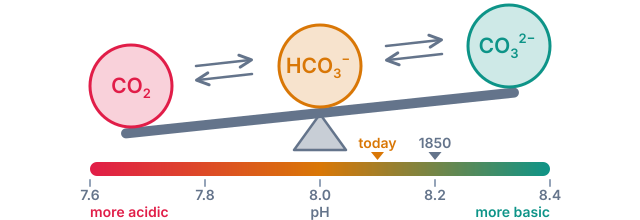
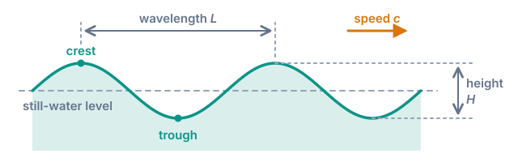

# Carbon in the Sound

Every Tidewell buoy carries a pH sensor, because the sea is slowly changing its chemistry. This page explains what our sensors see, from carbonic acid to the energy in a wave, using the numbers we actually work with.

\[
\ce{CO2(aq) + H2O <=> H2CO3 <=> H+ + HCO3- <=> 2H+ + CO3^2-}
\]

<p align="center"></p>

## The carbonate system

When carbon dioxide from the air dissolves in seawater, very little of it stays as CO₂. It reacts with water to form carbonic acid, which quickly gives up hydrogen ions. In the Sound this autumn, about 93 % of the dissolved inorganic carbon is bicarbonate \(\ce{HCO3-}\), about 6 % is carbonate \(\ce{CO3^2-}\), and under 1 % is dissolved CO₂.

The sea resists the change because carbonate soaks up most of the new hydrogen ions:

$$\ce{CO2 + CO3^2- + H2O -> 2HCO3-}$$

That buffer has a price. Each extra CO₂ molecule uses up a carbonate ion, and carbonate is what oysters, pteropods and corals build their shells from. Shells stay in balance with the water around them through \(\ce{CaCO3 <=> Ca^2+ + CO3^2-}\): take carbonate away and the balance leans toward dissolving.

## pH is a logarithm

pH counts hydrogen ions on a logarithmic scale[^scale]:

$$\mathrm{pH} = -\log_{10} a_{\mathrm{H^+}}$$

Here $a_{\mathrm{H^+}}$ is the activity of hydrogen ions, which in seawater closely tracks their concentration. Because of the logarithm, one pH unit is a factor of ten. Since about 1850 the surface ocean has gone from roughly 8.2 to 8.1, and Gannet Point averaged 8.02 in week 46.

> [!WARNING] A small number is a big change
> A drop of 0.1 in pH means $10^{0.1} \approx 1.26$ times as many hydrogen ions: 26 % more. When you write about two pH values, turn the difference into a ratio before you call it small.

## Will shells dissolve?

Whether calcium carbonate forms or dissolves depends on its saturation state, Ω (omega). It compares the ions actually in the water with what the water holds at equilibrium:

```math
\Omega_{\mathrm{arag}} = \frac{[\ce{Ca^2+}][\ce{CO3^2-}]}{K^{*}_{\mathrm{sp,arag}}} \tag{1}
```

$K^{*}_{\mathrm{sp,arag}}$ is the solubility product of aragonite, the form of calcium carbonate that corals and many young shellfish build. It depends on temperature, salinity and pressure.

| Ω | Seawater is | What it means for shells |
|:---:|---|---|
| > 1 | supersaturated | Shells and skeletons can form; the higher Ω, the less energy they cost |
| = 1 | in balance | Calcium carbonate neither forms nor dissolves |
| < 1 | corrosive | Unprotected aragonite starts to dissolve |

Gannet Point sat at Ω ≈ 2.0 in week 46[^omega]. That is comfortably above 1, but at the same alkalinity a drop of 0.1 in pH would take nearly a fifth off it.

## Oxygen and temperature

Oxygen reaches the Sound from the air and from everything green in it. At the surface the gas dissolves in proportion to its partial pressure, as Henry's law says: $c = k_H\,p$, where the constant $k_H$ falls as the water warms. In daylight, phytoplankton add their own:

$$\ce{6CO2 + 6H2O ->[light] C6H12O6 + 6O2}$$

==Warmer water holds less oxygen.== At Gannet Point's 12.6 °C and 33.8 PSU, fully saturated seawater holds about 8.6 mg/L. In week 46 the buoy read 7.9 mg/L, about 92 % of saturation. Back in August, at 17.4 °C, saturation was only 7.8 mg/L. [Leo's notebook](data-notebook.md#temperature-against-oxygen) measures the link across all twelve stations.

## Waves, briefly

Our buoys also log the sea state, because waves mix the water column and stir up the bottom.



For small waves, linear wave theory ties the angular frequency $\omega = 2\pi/T$ to the wavenumber $k = 2\pi/L$ and the water depth $h$:

\[
\omega^2 = g k \tanh(kh) \tag{2}
\]

In deep water ($kh \gg 1$, in practice deeper than half a wavelength), $\tanh(kh) \to 1$ and the period alone sets speed and length: $c = gT/2\pi$ and $L = gT^2/2\pi$. An 8-second swell travels at $c \approx \pu{12.5 m/s}$ and measures $L \approx \pu{99.9 m}$ from crest to crest. Over 20 m of water the same swell already feels the bottom: equation (2) gives about 89 m and 11.1 m/s.

### Energy in a wave

The energy a wave carries per square meter of sea surface grows with the square of its height:

$$E = \tfrac{1}{8}\rho g H^2$$

With $\rho = \pu{1025 kg/m^3}$, $g = \pu{9.81 m/s^2}$ and $H = \pu{1.5 m}$, that comes to about $\pu{2.83 kJ/m^2}$. Double the height and the energy grows fourfold[^hs].

## What our buoys measure

| Quantity | Symbol | Unit | Accuracy |
|---|:---:|:---:|---:|
| Temperature | $T$ | °C | ±0.10 |
| Salinity | $S$ | PSU | ±0.10 |
| pH, total scale | $\mathrm{pH_T}$ | — | ±0.05 |
| Dissolved oxygen | $\ce{O2}$ | mg/L | ±0.20 |
| Significant wave height | $H_s$ | m | ±0.10 |
| Peak wave period | $T_p$ | s | ±0.50 |

These are the accuracies after calibration. Between visits, sensors drift, which is why we check them against water samples taken by hand, like the ones from the *Petrel* in October ([Nine Days on the Petrel](field-journal.md)).

## Glossary

<abbr title="dissolved inorganic carbon">DIC</abbr>
: All the inorganic carbon dissolved in seawater: CO₂, carbonic acid, bicarbonate and carbonate together, usually given in µmol/kg.

Total alkalinity
: The water's capacity to neutralize acid, mostly bicarbonate plus twice the carbonate, plus a little borate. More alkalinity means a stronger buffer.

Aragonite
: A crystal form of calcium carbonate built by corals, pteropods and the larvae of many shellfish. It dissolves more easily than calcite, the other common form.

<abbr title="practical salinity unit">PSU</abbr>
: The label written after practical salinity, which is measured from conductivity. Strictly, practical salinity has no unit; 35 PSU is close to 35 grams of salt per kilogram of seawater.

[^scale]: Seawater pH is reported on the total scale, which counts free hydrogen ions plus those paired with sulfate. Our sensors report total-scale pH, so every pH on this page and in the [open data API](tidewell-api.md) is on the same scale.

[^omega]: Ω needs two measured parts of the carbonate system. We measure pH, estimate total alkalinity from salinity, and compute Ω with the standard equilibrium constants for seawater. Read the result as good to about ±0.2.

[^hs]: Real seas mix many waves of different heights. Our buoys report the significant wave height $H_s$, and the mean energy of such a sea is $E = \rho g H_s^2/16$. Gannet Point's week-46 $H_s$ of 1.4 m works out to about 1.2 kJ/m².

---

Next: [Ninety days of Sound data](data-notebook.md) · [Start here](README.md)
