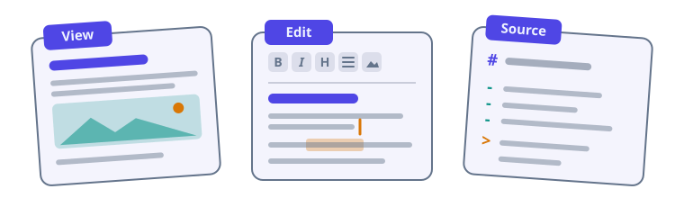
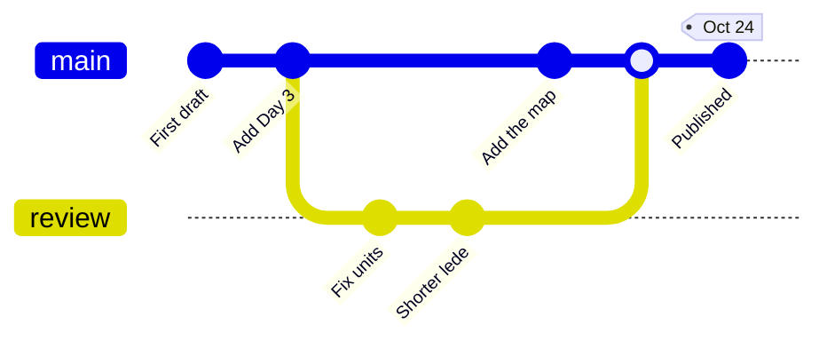
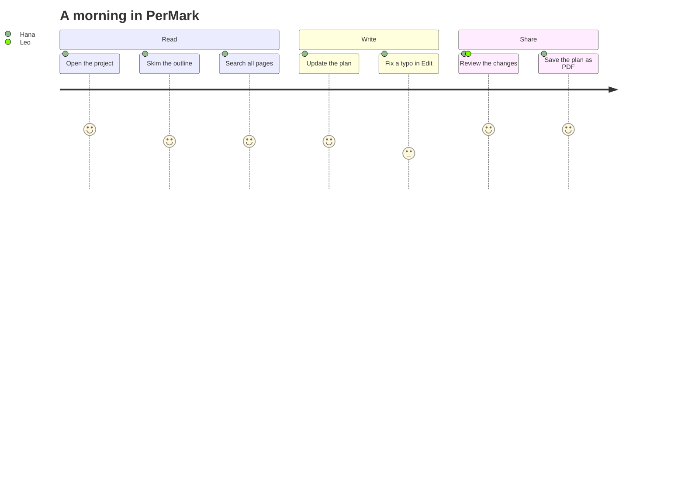

# Working in PerMark: a ten-minute tour

Every Larkhaven volunteer starts here. In ten minutes you'll know how to read, edit, review and share the lab's pages, and which helpers stay asleep until you call them.

  

## Your first five minutes

Tick these off on your first morning. The boxes are just Markdown, so you can copy the list into a note of your own.

- [x] Open this folder with **Open folder** (<kbd>Ctrl</kbd>+<kbd>O</kbd>)
- [x] Read the [start page](README.md)
- [ ] Switch one page to Edit and fix a word
- [ ] Leave Hana a comment on a passage
- [ ] Search all pages for "Kittiwake"

## Read first

PerMark opens every page in View. <mark>Reading is the main mode</mark>: nothing on the page turns into a tool until you ask for one.

Press <kbd>Ctrl</kbd>+<kbd>Alt</kbd>+<kbd>O</kbd> to show the outline, <kbd>Ctrl</kbd>+<kbd>F</kbd> to find a word on the page, and <kbd>Ctrl</kbd>+<kbd>Shift</kbd>+<kbd>F</kbd> to search every page in the project. Links between pages work like a website: open the [API reference](tidewell-api.md), then <kbd>Alt</kbd>+<kbd>←</kbd> brings you back. On macOS, press <kbd>Cmd</kbd> where this guide says Ctrl, and <kbd>Option</kbd> for Alt.

## Edit or Source

When a page needs changing, you have two editors. Pick the one that fits the job, and save with <kbd>Ctrl</kbd>+<kbd>S</kbd>.

| Mode | Keys | Best for | What you see |
|------|------|----------|--------------|
| View | <kbd>Esc</kbd> | Reading and presenting | The finished page |
| Edit | <kbd>Ctrl</kbd>+<kbd>E</kbd> | Writing and quick fixes | The same page, with a caret and a toolbar |
| Source | <kbd>Ctrl</kbd>+<kbd>Alt</kbd>+<kbd>E</kbd> | Tables, front matter, exact control | The Markdown text itself |

Whichever you use, saving is careful.

:::note Only your changes are saved
PerMark writes back only the characters you changed. Line endings, the order of the front matter and every comment in the file stay exactly as they were, so a one-word fix shows up as a one-word difference.
:::

## Notes and tags

Notes are for everything that isn't a page yet. <kbd>Ctrl</kbd>+<kbd>Shift</kbd>+<kbd>D</kbd> opens the Notes tab and <kbd>Ctrl</kbd>+<kbd>Shift</kbd>+<kbd>N</kbd> starts a new note: plain Markdown in a folder you choose, saved as you type, with earlier versions kept. Pin the ones you open every day.

Tags belong to pages. A `tags:` list in the front matter shows up as chips on the properties card at the top, like the three on this page. Press <kbd>T</kbd> to add tags and a one-line description without touching the file, and open the Tags panel to see every file that shares a tag.

## Comments on a passage

Select a passage and press <kbd>C</kbd> to leave a comment on it. Comments follow their words when the text around them changes, and the Comments list lets you reply, mark one done or jump back to the passage.

They live in the project's local state, never inside the file, so the page stays clean for everyone else. An agent you connect can read them and mark them done, and **Send to agent** copies them for its chat.

## Review what changed

When a page changed since you last read it, a bar offers to show you how: *Changed since you last read · 3 changes*. Step with <kbd>N</kbd> and <kbd>P</kbd>, keep a change with <kbd>K</kbd>, revert it with <kbd>R</kbd>.

In a git project, **Compare with** can also be *the last commit* or *an earlier version…*. Every commit that touched the page is there to compare with, and **Bring back this version** restores one, with Undo right afterwards.

## Share: PDF, HTML, print

Open the document's **…** menu and choose **Save as PDF…**, **Save as HTML…** or **Print…** (<kbd>Ctrl</kbd>+<kbd>Alt</kbd>+<kbd>P</kbd>). All three are built from the saved file with the reading view's look, diagrams and formulas included, and always in light colors, whatever your theme. Pick the paper size, margins and page numbers in the page setup. The HTML is a single self-contained file you can email to anyone.

## Spelling, correction, translation

Three helpers for words, all asleep until you call them. Spelling underlines misspelled words while you edit, in the page's own language; a dictionary is downloaded only when you say yes, and a right-click on a word offers suggestions.

**Correct spelling and grammar** (<kbd>Ctrl</kbd>+<kbd>Alt</kbd>+<kbd>K</kbd>) and **Translate** (<kbd>Ctrl</kbd>+<kbd>Alt</kbd>+<kbd>R</kbd>) run a small AI model on this computer. It is downloaded the first time you ask, and your text never leaves the machine. Practice on the box in the [field journal](field-journal.md#try-it-spelling-and-correction).

> [!IMPORTANT] Nothing changes until you accept
> Every suggestion and every translated part waits in a review bar. Keep it or discard it: the file changes only when you say so.

## Let an agent read the project

PerMark can share a project with an AI agent you already use, any tool that speaks MCP. It's off by default and set per project: turn on **Share this folder with agents** in Settings, under **AI agents**. You can always see which agents are connected.

While it's on, an agent can search and read this project's files, read your comments and the notes you share, and show you a place, but only on this computer, only while PerMark has the project open, and never by editing files through PerMark. Files listed in [`.aiignore`](.aiignore) stay out of its reach; this folder keeps `station/deploy.env` away that way. Our [bulletin agent](bulletin-agent.md) works exactly like this.

## Config and data files

Not everything in a project is Markdown. PerMark shows settings files (TOML, YAML, INI, `.env`) as clean sheets, and TOON data as a table. Open these from the `station/` folder:

- [`buoy.toml`](station/buoy.toml): one buoy's settings, sensor by sensor
- [`qc-rules.yaml`](station/qc-rules.yaml): the quality-control rules every reading passes through
- [`deploy.env`](station/deploy.env): environment values, with a placeholder key
- [`readings-week-46.toon`](station/readings-week-46.toon): a week of readings from all twelve stations
- [`ingest-2026-11-12.log`](station/ingest-2026-11-12.log): a day of server log; <kbd>Alt</kbd>+<kbd>Z</kbd> wraps the long lines

## A morning in PerMark

Here's how Hana's Monday usually goes, scored by how much she enjoys each step.

## Shortcuts

The eight you'll use most. The command palette (<kbd>Ctrl</kbd>+<kbd>Shift</kbd>+<kbd>P</kbd>) lists every command with its keys, and **Keyboard shortcuts…** lets you change them.

| Action | Keys |
|--------|------|
| Go to file | <kbd>Ctrl</kbd>+<kbd>P</kbd> |
| Search all pages | <kbd>Ctrl</kbd>+<kbd>Shift</kbd>+<kbd>F</kbd> |
| Find in page | <kbd>Ctrl</kbd>+<kbd>F</kbd> |
| Show or hide the outline | <kbd>Ctrl</kbd>+<kbd>Alt</kbd>+<kbd>O</kbd> |
| Edit, then back to View | <kbd>Ctrl</kbd>+<kbd>E</kbd> |
| Source mode | <kbd>Ctrl</kbd>+<kbd>Alt</kbd>+<kbd>E</kbd> |
| Comment on the selection | <kbd>C</kbd> |
| Print | <kbd>Ctrl</kbd>+<kbd>Alt</kbd>+<kbd>P</kbd> |

## Questions

> [!question]- Does reading a page ever change the file?
> No. Reading never writes. Comments live in the project's local state, and tags you add with <kbd>T</kbd> are kept beside your pages, not inside them.

> [!question]- Do I need git?
> No. PerMark works with any folder. In a git project, Review can also compare with the last commit and with earlier versions, and PerMark never fetches or pushes for you.

> [!question]- Can I switch features off?
> Yes. Each feature is a plugin you can turn off in Settings, under **Plugins**. Turned off, it leaves nothing behind on screen.

---

Next: [How we write](style-guide.md) · [Start here](README.md)
