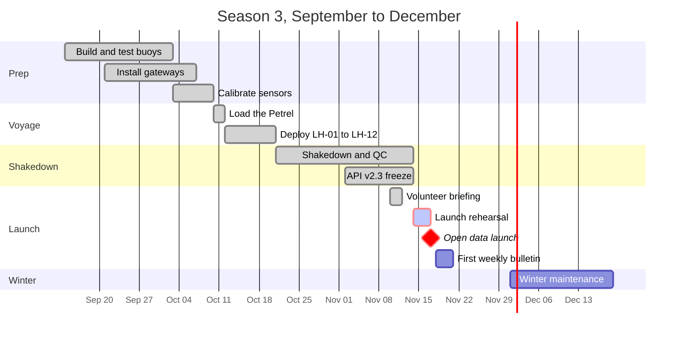
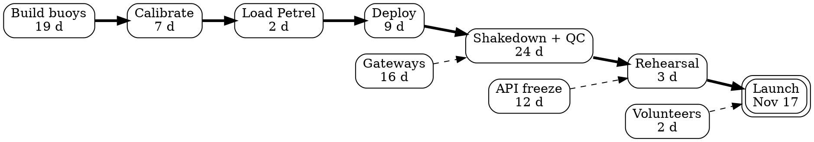
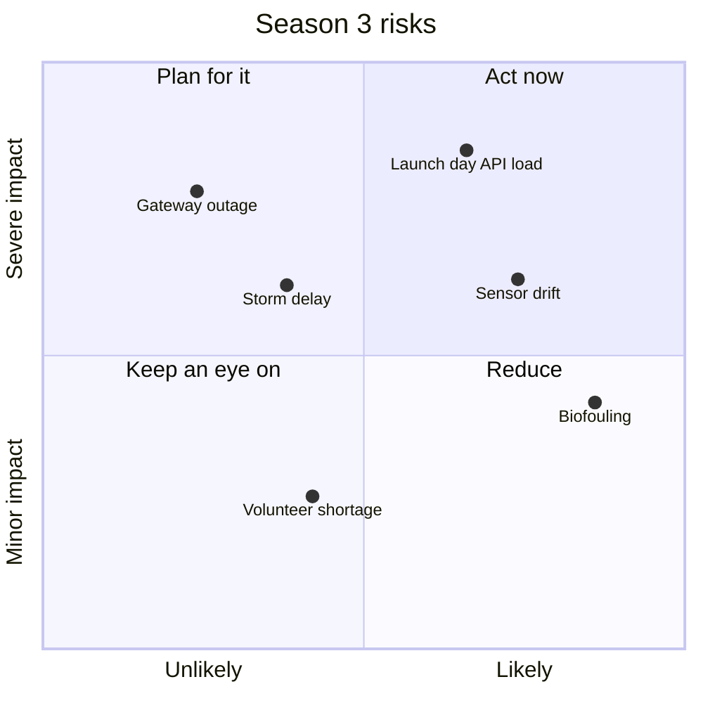
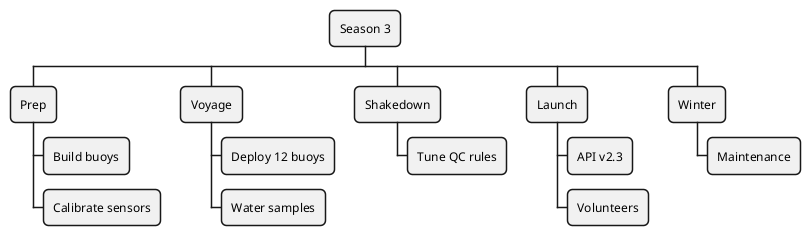

# Season 3 deployment plan

Twelve buoys are in the water and one dataset is about to open. This is where Season 3 stands, what is left before launch day, and what could still go wrong.

## Where we are

> [!IMPORTANT] Open data launch: Tuesday, November 17
> All twelve buoys are reporting, the QC rules are signed off and API v2.3 is frozen. Until launch, any change to the API needs a yes from both Tomás and Hana.

What remains is Monday's rehearsal, where the whole crew walks through launch day minute by minute, and then the launch itself.

## Milestones

| Milestone | Date | Owner | Status |
|---|---|---|---|
| Gateways online | Tue, Oct 6 | Tomás Varela | :white_check_mark: Done |
| Buoys built and calibrated | Fri, Oct 9 | Tomás Varela | :white_check_mark: Done |
| All twelve buoys deployed | Tue, Oct 20 | Beatriz Nogueira | :white_check_mark: Done |
| QC rules signed off | Fri, Nov 13 | Dr. Imani Okafor | :white_check_mark: Done |
| Launch rehearsal | Mon, Nov 16 | Hana Kowalski | :hourglass: In progress |
| Open data launch, API v2.3 | Tue, Nov 17 | Hana Kowalski | :calendar: Next |
| First weekly bulletin | Fri, Nov 20 | Leo Park | :calendar: Planned |
| Winter maintenance done | Fri, Dec 18 | Beatriz Nogueira | :calendar: Planned |

## Workstreams

Each lead keeps their own list here, so the whole plan stays on one page.

- **Platform** · Tomás
  - [x] Ingest receives readings from North Light, Avery Pier and Saddle Hill
  - [x] QC engine loads its rules from [`station/qc-rules.yaml`](station/qc-rules.yaml)
  - [ ] Load test API v2.3 at ten times the expected traffic
  - [ ] ~~Cellular fallback for Heron Flats~~ dropped, see the decision log below
- **Field** · Beatriz
  - [x] Deploy LH-01 to LH-12 from the *Petrel* ([journal](field-journal.md))
  - [x] Take a water sample at every station
  - [ ] Check the pH sensor at Kittiwake Shoal against a water sample
- **Data** · Leo
  - [x] Review the 90-day dataset ([notebook](data-notebook.md))
  - [ ] First bulletin drafted by Gull and signed off by Leo ([how it works](bulletin-agent.md))
- **Science** · Imani
  - [x] Sign off the QC thresholds
  - [ ] Publish a short guide to reading pH ([draft](ocean-chemistry.md#ph-is-a-logarithm))
- **Launch** · Hana
  - [x] Brief the volunteers
  - [ ] Monday rehearsal with the whole crew
  - [ ] Launch post for the lab's newsletter

## Critical path

Sixty-four days stood between the first buoy build and launch day, and every one of them sat on the chain of bold arrows below: a day lost there is a day lost at launch. The tasks on dashed arrows had slack.

## Budget

| Item | Detail | Cost (USD) | Share |
|---|---|---:|---:|
| Buoy hardware | 12 buoys × $1,850 | 22,200 | 45.7 % |
| Boat time | 9 days × $1,400 | 12,600 | 25.9 % |
| Calibration | sensors and reference samples | 3,900 | 8.0 % |
| Gateways | 3 × $950 | 2,850 | 5.9 % |
| Cloud and data | hosting, storage, transfer | 1,650 | 3.4 % |
| Contingency | held for repairs | 5,400 | 11.1 % |
| **Total** | | **48,600** | **100.0 %** |

Hardware and boat time are spent. The contingency carries us through winter maintenance.

## Risks

We rate each risk twice a month on two questions: how likely is it, and how much would it hurt?

The two risks in the top right get work this week; the rest have a standing answer.

> [!todo] Mitigations
> - **Launch day API load:** cache the latest-readings endpoint for 60 seconds and finish the load test before Monday.
> - **Sensor drift:** check the pH sensor at Kittiwake Shoal before December 1, and compare every pH sensor with a water sample on each visit.
> - **Gateway outage:** buoys keep unsent readings and resend them when the link returns; a spare gateway waits at Port Avery.
> - **Storm delay:** winter maintenance carries a five-day weather buffer.
> - **Biofouling:** copper mesh on the sensor cages, cleaned on every visit.
> - **Volunteer shortage:** two backups for every launch-day role.

## Work breakdown

The same season, cut into pieces of work instead of dates.

## Decisions

Decision log: four decisions that shaped the season

| Date | Decision | Why | By |
|---|---|---|---|
| Sep 30 | Take a water sample at every station during the voyage | Gives each pH and oxygen sensor a reference point | Dr. Imani Okafor |
| Oct 22 | Publish flagged readings with their flag instead of deleting them | People can judge for themselves, and nothing disappears silently | Dr. Imani Okafor |
| Nov 4 | Drop the cellular fallback for Heron Flats | LoRa through Saddle Hill delivers 96 % of readings on time, and the buoy resends the rest ([why LoRa](station-architecture.md#decision-lora-not-cellular)) | Tomás Varela |
| Nov 10 | Launch on Tuesday, not Monday | Leaves a full working day for the rehearsal | Hana Kowalski |

---

Next: [Moqueca for twelve](galley-recipe.md) · [Start here](README.md)
