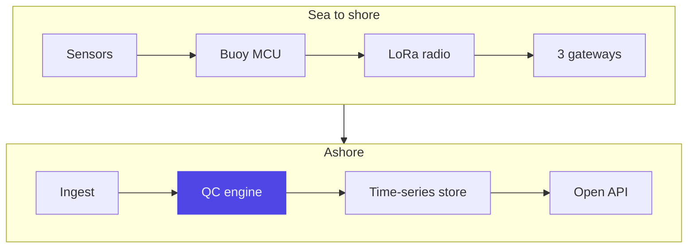
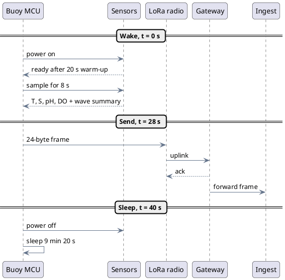
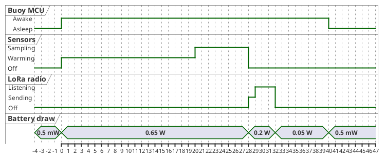
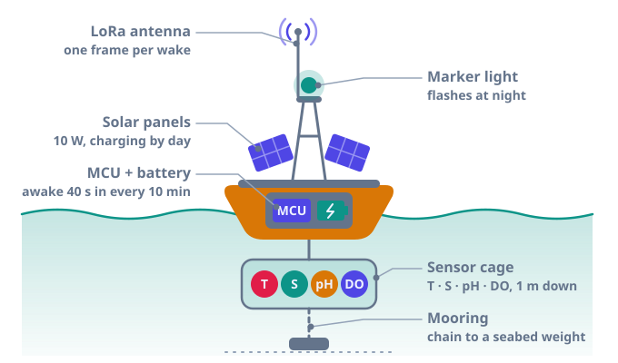
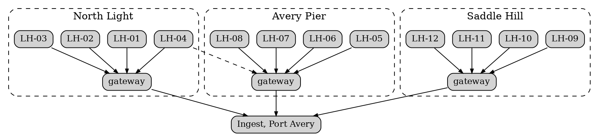
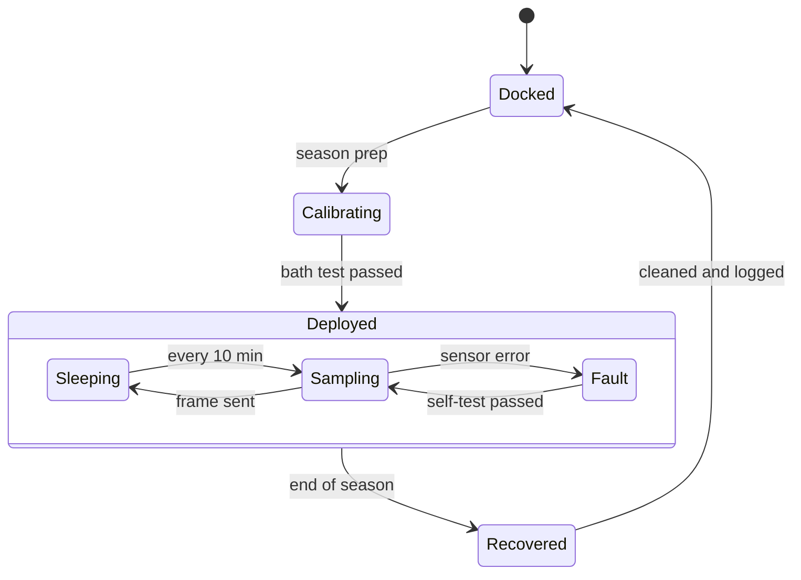
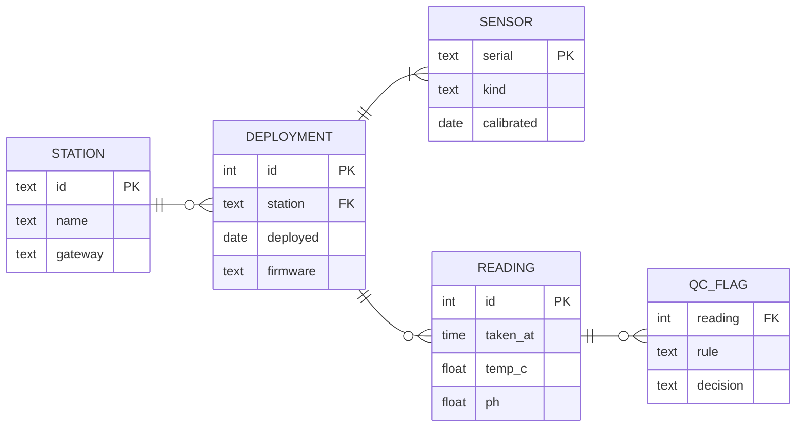

# How a reading travels

Every ten minutes, twelve buoys on Larkhaven Sound wake up, measure the water and go back to sleep. This page follows one reading from a sensor one meter down to your screen, a trip of less than a minute.



From the API, the same numbers reach the harbor dashboard, Gull's weekly bulletin and any researcher who asks. Nothing on this path is exotic: each part is small, boring and replaceable, which is exactly what you want from equipment that spends the winter in salt water.

## The 40-second wake cycle

A buoy spends most of its life asleep. Its <abbr title="microcontroller unit">MCU</abbr> wakes on a timer, powers the sensors, takes a reading, sends it and goes back to sleep. One wake lasts 40 seconds; the other 9 minutes and 20 seconds are quiet.



The gateway answers the radio at once and forwards the frame on its own time, so the radio never waits for the shore. Its listening window stays at three seconds.

## Power during a wake

Where does the energy go? Mostly into warming up the sensors. The radio, despite its reputation, is on for barely four seconds.



Add it up and one wake costs about 19 joules. With the wave sensor ticking along between wakes, a buoy uses under 1 Wh a day: the 10 W panels earn that back in a few minutes of full sun, and the 154 Wh battery could carry a buoy through five months of gray skies.

## Inside a buoy

Each buoy is a float, a short tower and a sensor cage, held in place by a chain. The electronics bay sits inside the float, just above the waterline.



## Twelve buoys, three gateways

The buoys talk to three gateways on shore, four buoys each. Every buoy also knows a fallback gateway; the dashed line shows Gannet Point's.



When a gateway loses its link to shore, it buffers frames and replays them later. The [ingest log for November 12](station/ingest-2026-11-12.log) shows Saddle Hill doing exactly that, with no reading lost.

## A buoy's life

A buoy is always in one of a few states. Most of the season it simply alternates between sampling and sleeping.



## The data model

Behind the API sit five tables. A station hosts one deployment for every buoy moored there; each deployment carries its sensors and records its readings; a reading may collect QC flags.



Readings belong to a deployment, not to a station. A buoy swapped mid-season never mixes its numbers with its replacement's.

## Configuration

Two plain files steer the whole pipeline. The buoy reads [its settings](station/buoy.toml) at every boot, and the ingest service checks each reading against [the QC rules](station/qc-rules.yaml). Here are the first lines of the rules:

```yaml title="station/qc-rules.yaml" {4-6}
# Tidewell QC rules, applied by the ingest service to every reading.
# Units follow each sensor: °C, PSU, pH units, mg/L and meters.
version: 3
order: [range, spike, flatline, drift]
reject_on: [range]
publish_flagged: true

# Physical limits as [min, max]. Outside them, a reading is rejected.
range:
  temp_c: [-2.0, 35.0]
  sal_psu: [0.0, 42.0]
  ph: [7.2, 8.6]
  do_mgl: [0.0, 15.0]
  hs_m: [0.0, 12.0]
```

Lines 4 to 6 are the whole policy: the order of the checks, the one failure that rejects a reading outright, and the promise that flagged readings are still published, flag attached. When you want to point a colleague at a rule, a reference like `station/qc-rules.yaml:5` opens the file at that line. The early warning about Kittiwake Shoal's pH sensor is at `station/ingest-2026-11-12.log:22`.

## Decision: LoRa, not cellular

We chose the radio before we chose anything else, because it decides the battery, the budget and where buoys can go.

<details>
<summary>ADR-007 · Use LoRa with our own gateways (accepted, June 2025)</summary>

**Context.** Buoys send 24 bytes every 10 minutes from up to 14 km offshore. The inner Sound, around Heron Flats, has patchy cell coverage.

| Option | Range over water | Energy per send | Cost per buoy, 5 years | Verdict |
|---|---|---:|---:|---|
| <abbr title="Long Range, a low-power radio protocol">LoRa</abbr>, 3 own gateways | 10–15 km | 0.4 J | $263 | Chosen |
| LTE-M cellular | patchy past Saddle Hill | 4 J | $345 | Fallback study |
| Satellite short-burst | anywhere | 20 J | $10,760 | Too costly |

**Decision.** LoRa in the US915 band, spreading factor 9, three gateways on land we can reach by car.

**Consequences.** No monthly fees and no gaps, but we maintain three gateways ourselves. Frames must stay small: at spreading factor 9, a frame has to fit in the band's 400 ms limit on air.

</details>

---

Next: [Tidewell Open Data API](tidewell-api.md) · [Start here](README.md)
