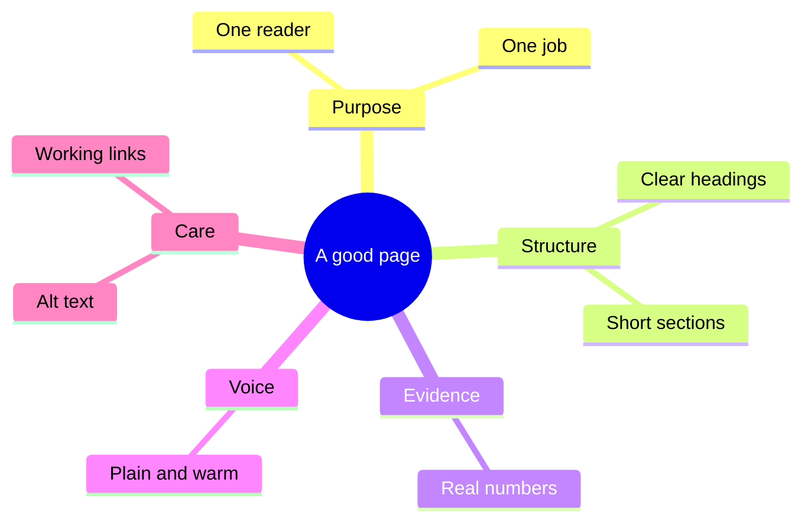

# How we write: the Larkhaven style guide

Good pages get read. This is how we keep ours short, true and kind to the reader, with a quick reference to every mark Markdown gives you.



## Write for one reader

Before you type, name one reader and the one job they came to do. A volunteer on the pier at six in the morning needs the swap checklist, not the history of LH-09. Everything else moves lower, or goes.

That reader is sometimes an agent. Gull reads our pages too, so the same rules apply: say what you mean, give numbers their units and dates. Its own [prompt file](bulletin-agent.md) shows how tags like `<context>` and placeholders like `{{week}}` read on the page.

Three questions before you publish:

1. Who is this page for?
2. What will they do after reading it?
3. Which number would they quote?

## Headings, lists and tasks

One title, then sentence-case sections, one idea each. Use a list when the reader will scan or tick things off, and nest one level at most. You type:

```markdown
1. Hull
   - Inspect the hatch seal
   - Clean the solar panel
2. Sensors
   - [x] Calibrate pH
   - [ ] Replace the oxygen membrane
```

You get:

1. Hull
   - Inspect the hatch seal
   - Clean the solar panel
2. Sensors
   - [x] Calibrate pH
   - [ ] Replace the oxygen membrane

## Callouts: pick the right voice

A callout lifts one piece of advice out of the text. Choose the kind by what happens if the reader skips it: NOTE for context, TIP for a shortcut, IMPORTANT for what they must know, WARNING for a risk, CAUTION for anything that can't be undone.

> [!NOTE] Station ids
> Write station ids as `LH-` plus two digits: LH-04, never LH4 or lh-04. Search finds them all that way.

> [!TIP] Keep the units
> Paste readings with their units, straight from the API. Nobody should have to guess whether 12.6 means °C.

> [!IMPORTANT] Every number has a date
> "Mean pH 8.02" means nothing on its own. "Mean pH 8.02 at LH-04, week 46" is a fact.

> [!WARNING] Flagged readings
> A flagged reading may be wrong. Quote it only with its flag, and say why the flag was raised.

> [!CAUTION] Deleting history
> Removing a reading from the open dataset can't be undone for people who already downloaded it. Ask Imani first.

## More callout kinds

For stories and side notes, these kinds fold away. Closed, they make a colored index; click a title to open one.

> [!info]- How a station gets its name
> Named stations take the nearest charted landmark: Gannet Point, Kittiwake Shoal, Heron Flats. The rest keep their numbers until someone earns the right to name one.

> [!success]- What "deployed" means
> A buoy counts as deployed when its first reading passes quality control, not when it hits the water.

> [!question]- Why ten minutes between readings?
> Ten minutes is short enough to catch a turning tide or a passing storm, and a 40-second wake keeps the battery alive through a northern winter.

> [!failure]- What we got wrong in Season 2
> We published raw salinity before the sensors were calibrated. Two weeks of LH-09 had to be reissued, with an apology.

> [!danger]- Never on deck alone
> A buoy swap needs two people on deck and one at the wheel. No exceptions, not even in a flat calm.

> [!bug]- Known issue: clock drift after a battery dip
> A buoy whose battery dips too low can restart with its clock a few seconds off. Ingest corrects it, but mention it if timestamps look odd.

> [!abstract]- This guide in one paragraph
> One reader, one job. Short sections with clear headings. Real numbers with units and dates. Plain, warm words. Alt text on every picture and links that work.

> [!todo]- Before you publish
> Check the spelling and every link, read the page once aloud, and ask one person who wasn't in the room to read it too.

## Containers

When an aside runs longer than a callout, use a container: a titled block that can hold paragraphs, lists or even a table.

:::note Containers hold longer asides
Open one with three colons and a kind, then close it with three colons on a line of their own. Everything in between is ordinary Markdown.
:::

:::tip Which one to use
A callout for one piece of advice, a container for a sidebar, and a `<details>` block for things most readers can skip.
:::

## Small marks

A handful of inline marks covers almost everything else. Use each one for its job, and sparingly.

| You type | You get | Use it for |
|----------|---------|------------|
| `==rising tide==` | ==rising tide== | The one line a skimming reader must not miss |
| `<mark>flagged</mark>` | <mark>flagged</mark> | A highlight that works in any Markdown tool |
| `<kbd>Ctrl</kbd>+<kbd>F</kbd>` | <kbd>Ctrl</kbd>+<kbd>F</kbd> | Keys to press |
| `<abbr title="practical salinity unit">PSU</abbr>` | <abbr title="practical salinity unit">PSU</abbr> | The first use of an abbreviation |
| `CO<sub>2</sub>, 10<sup>3</sup>` | CO<sub>2</sub>, 10<sup>3</sup> | Chemistry and powers |
| `<ins>v2.3</ins>` | <ins>v2.3</ins> | Text added in a revision |
| `~~v2.2~~` | ~~v2.2~~ | Text removed in a revision |
| `:ocean:` | :ocean: | One emoji in a heading or a table, at most |

<a name="glossary" id="glossary"></a>

## Words we use

The same thing always gets the same word. These five come up on almost every page.

Station
: A fixed point in the Sound, `LH-01` to `LH-12`. Buoys come and go; stations stay.

Reading
: One set of measurements from one station at one moment: temperature, salinity, pH, dissolved oxygen and wave height.

QC flag
: A mark our quality-control engine puts on a doubtful reading. Most flagged readings are published with their flag; the rest are removed after a person reviews them.

Deployment
: One buoy at one station, from the day it goes in to the day it comes out.

Bulletin
: The weekly summary for the public. Gull drafts it, and a person signs it off.

## Front matter

Start each page with a few facts about it between two `---` lines. PerMark shows them as a properties card, with tags as chips. Five fields is plenty:

```yaml
---
title: Season 3 deployment plan
owner: Hana Kowalski
status: in progress
updated: 2026-11-15
tags: [plan, season-3, operations]
---
```

Prefer TOML? Open and close with `+++` instead, as the [galley recipe](galley-recipe.md) does.

## Links and anchors

Link to other pages by their relative path, and to a section by its heading in lowercase with dashes. For a spot that has no heading, drop in a named anchor. Web addresses become links on their own.

```markdown
[the season plan](season-plan.md)
[back to callouts](#callouts-pick-the-right-voice)
<a name="glossary"></a> … then [the glossary](#glossary)
https://tidewell.example
```

Try them: [the season plan](season-plan.md), [back to callouts](#callouts-pick-the-right-voice), [the glossary](#glossary), and https://tidewell.example.

---

Next: [How a reading travels](station-architecture.md) · [Start here](README.md)
