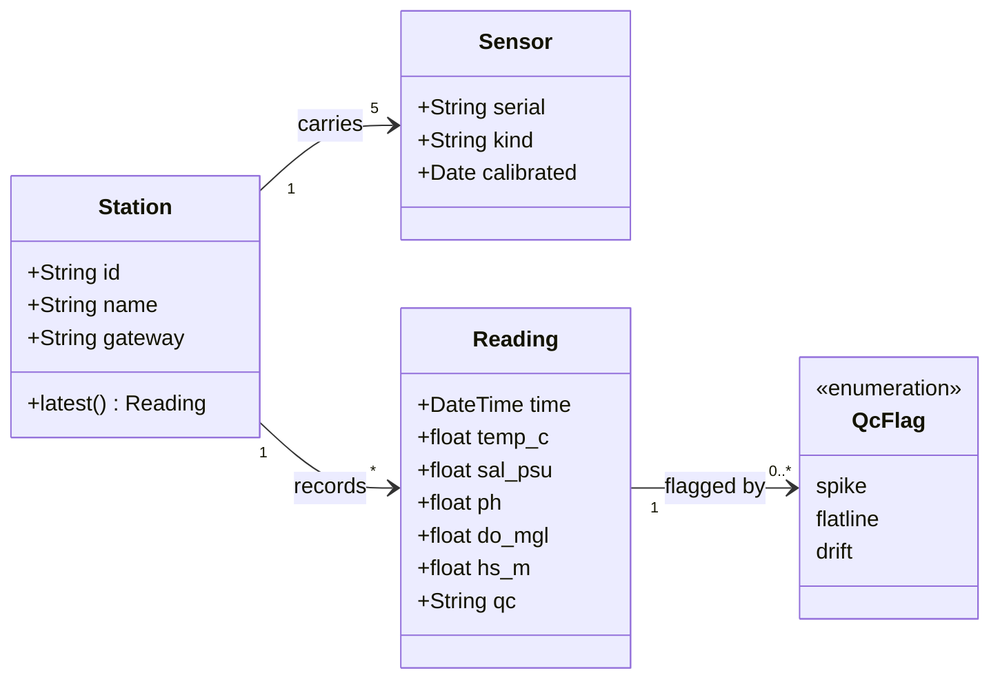
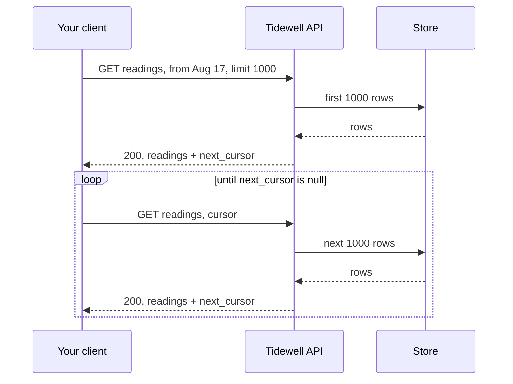
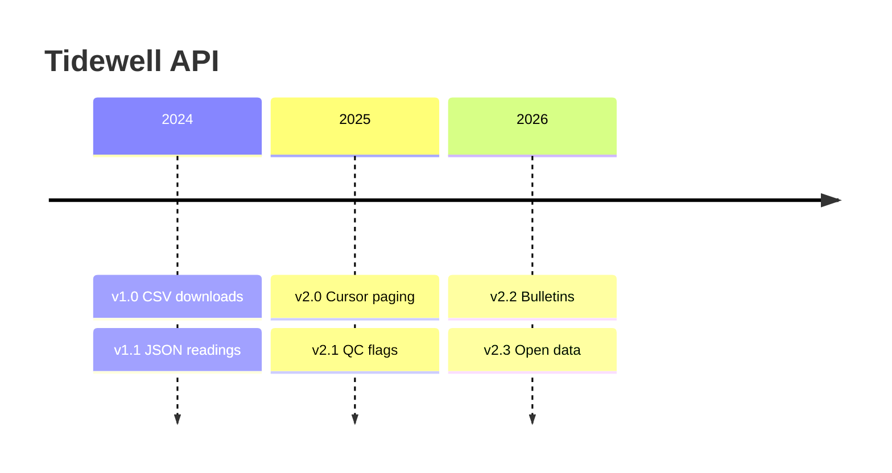

# Tidewell Open Data API

Every reading from every Tidewell buoy, free to use, in plain JSON. You don't need to sign up: a key only raises your rate limit.

> [!NOTE] Base URL
> Every endpoint lives under <https://api.tidewell.example/v2>. Times are ISO 8601 in <abbr title="Coordinated Universal Time">UTC</abbr>, and values use the units of the [buoy settings](station/buoy.toml).

```bash title="Quickstart"
# The newest reading from Gannet Point. No key needed.
curl -s https://api.tidewell.example/v2/stations/LH-04/latest \
  -H "X-Tidewell-Client: my-first-script/1.0"
```

## Authentication

Two headers matter. Both are plain text, and neither is required for your first request.

`Authorization`
: Optional. `Bearer <your key>`. A free key raises your limit from 60 to 600 requests a minute.

`X-Tidewell-Client`
: Recommended. Your app's name and version, such as `harbor-dashboard/4.1`, so we can reach you before we have to slow down a runaway script.

> [!WARNING] Keep keys out of your pages
> Never paste a key into a document, a notebook or a chat. Keep it in an environment file like [`station/deploy.env`](station/deploy.env), and list that file in [`.aiignore`](.aiignore) so agents connected through PerMark never see it. Our own services read the base URL from `station/deploy.env:4`.

## Endpoints

All endpoints answer `GET` and return JSON, except bulletins, which come back as Markdown. Limits are per minute with a free key.

| Method | Path | Returns | Limit/min |
|---|---|---|---:|
| `GET` | `/v2/stations` | All twelve stations | 600 |
| `GET` | `/v2/stations/{id}` | One station and its current deployment | 600 |
| `GET` | `/v2/stations/{id}/latest` | The newest reading | 600 |
| `GET` | `/v2/stations/{id}/readings` | Readings in a time range, paged | 120 |
| `GET` | `/v2/flags` | <abbr title="quality control">QC</abbr> flags and review decisions | 120 |
| `GET` | `/v2/bulletins/{week}` | The weekly bulletin | 60 |

## Readings

`/v2/stations/{id}/readings` is the workhorse. It takes five query parameters:

`from`, `to`
: Start and end of the range. At most 31 days apart; `to` defaults to now.

`fields`
: Comma-separated values to return, such as `temp_c,do_mgl`. Default: all five.

`qc`
: `published` (the default: passed and flagged readings) or `passed` (clean readings only).

`limit` and `cursor`
: Up to 1,000 readings per page, 500 by default. For the next page, pass back the `next_cursor` you received.

Here is one reading from Gannet Point, asked for with `?from=2026-11-14T09:40:00Z&limit=1`:

```json title="200 OK" {3,7-9}
{
  "station": "LH-04",
  "next_cursor": "MjAyNi0xMS0xNFQwOTo1MDowMFo",
  "readings": [
    {
      "time": "2026-11-14T09:40:00Z",
      "qc": "flagged",
      "flags": ["spike:do_mgl"],
      "do_mgl": 9.4,
      "temp_c": 12.6,
      "sal_psu": 33.8,
      "ph": 8.02,
      "hs_m": 1.4
    }
  ]
}
```

Line 3 is your bookmark for the next page. Lines 7 to 9 show a flagged reading: oxygen jumped 1.5 mg/L in ten minutes, more than the spike rule allows, so the value is published with a flag instead of quietly dropped. Whether to trust it is your call.

## Client examples

Any HTTP client works. These three print the newest reading from Gannet Point.

### Rust

Add `reqwest` with the `blocking` and `json` features, and `serde` with `derive`.

```rust title="examples/latest.rs" showLineNumbers {9-14}
use serde::Deserialize;

#[derive(Deserialize)]
struct Reading { time: String, temp_c: f64, do_mgl: f64, qc: String }
#[derive(Deserialize)]
struct Latest { station: String, reading: Reading }

fn main() -> Result<(), Box<dyn std::error::Error>> {
    let latest: Latest = reqwest::blocking::Client::new()
        .get("https://api.tidewell.example/v2/stations/LH-04/latest")
        .header("X-Tidewell-Client", "latest-example/1.0")
        .send()?
        .error_for_status()?
        .json()?;
    let r = latest.reading;
    println!("{} {}: {} °C, {} mg/L ({})", latest.station, r.time, r.temp_c, r.do_mgl, r.qc);
    Ok(())
}
```

`error_for_status` turns a 4xx or 5xx answer into an error, so a typo in the station id fails loudly instead of printing nonsense.

### Python

```python title="latest.py"
import os
import requests

headers = {"X-Tidewell-Client": "latest-py/1.0"}
if key := os.environ.get("TIDEWELL_KEY"):
    headers["Authorization"] = f"Bearer {key}"

url = "https://api.tidewell.example/v2/stations/LH-04/latest"
resp = requests.get(url, headers=headers, timeout=10)
resp.raise_for_status()
r = resp.json()["reading"]
print(f"{r['time']}: {r['temp_c']} °C, {r['do_mgl']} mg/L ({r['qc']})")
```

<details>
<summary>TypeScript, with fetch</summary>

```ts title="latest.ts"
type Reading = { time: string; temp_c: number; do_mgl: number; qc: "passed" | "flagged" };

const res = await fetch("https://api.tidewell.example/v2/stations/LH-04/latest", {
  headers: { "X-Tidewell-Client": "latest-ts/1.0" },
});
if (!res.ok) throw new Error(`Tidewell answered ${res.status}`);

const { reading } = (await res.json()) as { reading: Reading };
console.log(`${reading.time}: ${reading.temp_c} °C, ${reading.do_mgl} mg/L (${reading.qc})`);
```

</details>

## Data model

The API speaks in three objects and one short list of flags. A flag never replaces a value; it travels with it.



## Paging through history

Ninety days of one station is 12,960 readings, so history comes in pages. Keep asking until `next_cursor` comes back empty.



## Errors

Errors come back as JSON with a stable `code` you can match on, and a human-readable `message` you shouldn't.

| Status | Code | Meaning | Retry? |
|---:|---|---|---|
| 400 | `bad_range` | `from` is after `to`, or the range is over 31 days | No, fix the query |
| 401 | `bad_key` | The key is unknown or was revoked | No |
| 404 | `no_station` | No station has that id | No |
| 429 | `rate_limited` | Too many requests this minute | Yes, after `Retry-After` |
| 503 | `catching_up` | A gateway is replaying buffered frames | Yes, with backoff |

## Rate limits

Limits are counted per key, or per address without one. Every answer carries `X-RateLimit-Remaining`.

| Client | Requests/min | Burst | Requests/day |
|---|---:|---:|---:|
| No key | 60 | 10 | 5,000 |
| Free key | 600 | 50 | 100,000 |
| Partner key | 3,000 | 200 | 1,000,000 |

## Versions

Version 2.3 ships with the open data launch on Tuesday, November 17, 2026.



<details>
<summary>What changed in v2.3</summary>

- **New:** requests without a key, up to 60 a minute.
- **New:** `qc=passed` returns clean readings only.
- **Changed:** ~~`/v1/latest?station=LH-04`~~ is now <ins>`/v2/stations/{id}/latest`</ins>. The old path answers `410 Gone`.
- **Changed:** flags name the value they apply to, as in `spike:do_mgl`.

</details>

---

Next: [Gull, the weekly bulletin agent](bulletin-agent.md) · [Start here](README.md)
